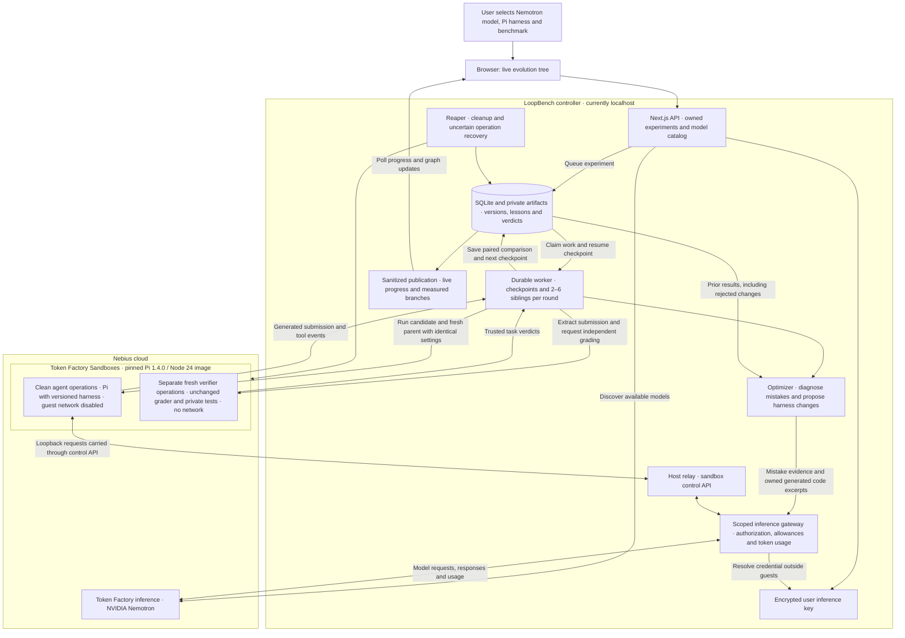

# LoopBench

## Nebius and NVIDIA architecture

NVIDIA Nemotron powers both the Pi coding agent and the optimizer that proposes changes to its harness. Nebius Token Factory provides model inference and isolated Sandbox execution. The diagram shows the current localhost demo: the browser, API, worker and evidence store run on the developer's machine; inference and task execution run in Nebius.



Each branch represents an executed harness version, not a separate model or one API call. The optimizer proposes 2–6 distinct changes from a selected parent. Pi runs each candidate and a fresh parent comparison on the same benchmark and model settings. A candidate is accepted only when its complete paired task pass rate improves. Rejected changes remain in the evidence used for later proposals. New rounds continue from eligible versions; operator controls, provider availability and resource allowances can pause execution.

For Token Factory Sandboxes, Pi sends inference requests to a loopback relay. The trusted controller carries those requests through the sandbox control API to LoopBench's gateway, which calls Nemotron and records usage. This lets the guest run without external networking or a real Nebius API key. Private acceptance tests run only in the fresh verifier. E2B remains an alternative execution provider, fixed when a campaign starts.

The implementation is in [sandbox execution](hosted/tokenfactory-sandboxes.ts), [inference gateway](hosted/gateway.ts), [optimizer](hosted/optimizer.ts), [evolution worker](hosted/worker.ts) and [publication](hosted/publication.ts). See [the Token Factory execution design](docs/TOKEN-FACTORY-SANDBOXES.md) for the request sequence and isolation details.

### Architecture narration · approximately 35 seconds

> LoopBench uses NVIDIA Nemotron in two roles: it powers the Pi coding agent, and it analyzes mistakes to propose competing harness improvements. Both use Nebius Token Factory inference through our gateway, which protects API keys and records token usage. Token Factory Sandboxes run each candidate and its parent in clean environments. A separate verifier checks their solutions against private tests. LoopBench saves every outcome and feeds the evidence into the next round. The tree shows measured harness evolution. Today, the controller runs on localhost; AI execution runs in Nebius.

Token Factory Sandboxes is now an execution option alongside E2B. A real pinned Pi 1.4.0 / Node v24.15.0 image, offline controller probe, six-task baseline and Nemotron-generated sibling hypotheses have run on the whitelisted project. New experiments default to Token Factory. Each lineage keeps its original provider. See [Token Factory execution](docs/TOKEN-FACTORY-SANDBOXES.md) and [validation](docs/VALIDATION.md).

Public tree pages follow newer published checkpoints, including fresh-parent progress and waiting reasons. Original snapshots remain immutable and can be inspected separately.

```powershell
npm run hosted:token-runtime
npm run hosted:token-probe
npm run hosted:token-pilot
npm run hosted:token-pilot -- --resume
```

The operator configures `NEBIUS_API_KEY` and `NEBIUS_PROJECT_ID` for sandbox compute. Browser users still connect their own inference keys. Token Factory's raw sandbox cost units are unconfirmed, so real operation/resource observations are retained with dollar cost unavailable. The earlier project validation spending restriction was lifted by the user; unrelated visitors' default allowances remain explicit.

LoopBench has run real NVIDIA Nemotron Lightning inference through Nebius Token Factory, with Pi 1.4.0 / Node v24.15.0 in E2B. The pilot completed a six-task baseline and two fresh paired sibling comparisons; both siblings tied and were rejected. Its production-build public HTTPS graph, node selection and Tree/Stats controls passed in-app browser checks. [Validation evidence](docs/VALIDATION.md) records the results, cost and retained unscored cleanup failure. The demo runs locally through a temporary tunnel; permanent Linux deployment remains pending.

The owned browser workflow, encrypted Nebius connection, metered inference gateway and durable evolution scheduler are implemented. An empty catalog stays empty until actual execution creates evidence. See the [hosted runbook](docs/HOSTED-RUNBOOK.md), [implementation status](docs/superpowers/plans/2026-10-27-hosted-pi-e2b-implementation.md#implementation-status--28-october-2026) and [architecture](docs/ARCHITECTURE-HOSTED.md).

## Hosted workspace

```powershell
npm ci
npm run hosted:init
npm run dev
```

Open [setup](http://127.0.0.1:3000/setup). Initialization adds missing local session/vault settings while preserving existing provider keys. The browser connects a Nebius key over the API; keys are encrypted on the server and never saved in browser storage. The catalog fetches real enabled models and prices. Nemotron powers both Pi and the optimizer, with no automatic fallback to an expensive model.

Actual execution additionally needs the platform E2B key, a reachable HTTPS gateway, a verified pinned runtime manifest and compute price/profile. Use [.env.hosted.example](.env.hosted.example) and the [runbook](docs/HOSTED-RUNBOOK.md). `npm run hosted:preflight` reports missing prerequisites without spending money. When ready, run `npm run hosted:worker` and `npm run hosted:reaper` in separate processes. These commands load `.env.local`; production can supply a private service environment instead.

The frontend creates owned experiments and polls the horizontal tree. Each round saves 2–6 distinct same-parent proposals, runs all six tasks with fresh paired parent evidence, retains rejected branches and continues to independent harder cases after a complete mastered round. Graph nodes represent started executions. Resource limits checkpoint work instead of manufacturing improvement or declaring evolution complete.

LoopBench's E2B demo ledger is cumulative across all users: USD100 ceiling, USD90 ordinary admission, USD5 initial campaign compute. Nebius inference is separate, initially USD0.20 per campaign with an explicit increase capped at USD0.50. A planned USD5 Nebius top-up is neither a confirmed balance nor a per-campaign grant. Unknown usage stays reserved; provider bills may require reconciliation. The pilot pins non-thinking chat-template behavior for both agent and optimizer to control inference cost.

The recorded demo has an explicit USD0.50 total inference approval across its campaigns. Earlier obligations were deducted when setting the current campaign allowance; this approval is separate from the user's account balance and the E2B compute budget.

`npm run hosted:verify` checks the real running HTTP service and, when `NEBIUS_API_KEY` is configured locally, read-only provider discovery. It starts no paid inference or sandbox. Operator runtime approval, selected archive import and verified lesson export are documented in the runbook. Lesson JSONL export is implemented; uploading to Data Lab or fine-tuning a model has not been performed.

LoopBench evolves agent harnesses through measured experiments. An evolution campaign diagnoses recorded mistakes, proposes competing harness changes, evaluates real branches and carries their lessons into the next round. The Petri-inspired viewer shows the entire lineage and the evidence behind each decision. A child reruns its parent and is accepted only when its task pass rate improves in that paired run. Failed attempts stay visible.

The benchmark registry includes a three-task smoke check and a six-task adversarial coding suite. Continuous campaigns extend the latter with independently computed expected answers, fresh cases and permanent regression pins. A new challenge first measures the unchanged champion and does not count as a learned improvement. These are function-level evaluations; they do not establish broad coding ability or statistically validated improvement. There are no seeded experiment trees. Real execution creates the history.

## Existing local CLI

Use Node.js 24+ and npm. The built-in Codex adapter also needs an installed, configured `codex` CLI and a model that it can access.

```powershell
npm ci
npm run dev
```

With hosted mode disabled, open [the local viewer](http://127.0.0.1:3000). In another terminal:

```powershell
npm run cli -- adapters
npm run cli -- benchmark list
npm run cli -- run --adapter codex-cli --domain coding --model MODEL --harness codex-cli --benchmark coding-adversarial-v1 --hypothesis "Establish the adversarial coding baseline"
```

Replace `MODEL` with an actual model ID available to your CLI. Runs write to `.loopbench` by default. The viewer reads the same directory every two seconds while visible. Set `LOOPBENCH_HOME` to the same absolute directory in both terminals if you want another location.

Use the returned baseline ID to start continuous, competing, evidence-grounded changes. The CLI defaults to continuous mode; `--continuous` makes it explicit:

```powershell
npm run cli -- evolve --continuous --adapter codex-cli --domain coding --model MODEL --harness codex-cli --benchmark coding-adversarial-v1 --parent BASELINE_UUID --beam-width 2 --max-calls 80
npm run cli -- campaigns
npm run cli -- campaign CAMPAIGN_ID
npm run cli -- inspect NODE_ID
```

Each evolution round tests 2-6 distinct siblings. New continuous campaigns choose the count adaptively from measured failure evidence; add `--branches N` with N from 2 through 6 to fix the count. The proposer diagnoses recorded mistakes and creates the required competing changes.

Later generations receive prior evidence, including rejected branches, and record what each change learned. Continuous mode has no fixed generation or lifetime candidate limit. The sibling count and `beam-width` size the current batch and eligible frontier; they do not cap the full lineage. Even a perfect suite must complete a sibling round on that suite before advancing to a fresh verified challenge in the same lineage. Ties and regressions remain measured evidence. Reaching the call allowance records a waiting checkpoint rather than completed evolution. Improvement is established by tests, never assumed from a proposal.

`max-calls` counts adapter invocations, including fresh parent reruns and challenge checkpoints. An external CLI can make internal model/tool requests, so this is not a provider billing cap. Continue a resource checkpoint with `evolve --resume CAMPAIGN_ID --grant-calls 80`. The ledger retains spent attempts and existing evidence. `pause CAMPAIGN_ID`, `resume CAMPAIGN_ID` and `stop CAMPAIGN_ID` preserve the recorded lineage. A challenge without a trusted extension waits as `waiting_challenge`. See [continuous evolution](docs/CONTINUOUS-EVOLUTION.md) and [the learning workflow](docs/EVOLUTION.md).

For a manual intervention, use `run --parent BASELINE_UUID --hypothesis "Your prediction" --instructions "Complete replacement instructions"` with the same adapter/domain/model/harness/benchmark flags. `digest` and `list` return a compact catalog without inference. Browser controls copy commands; execution happens in the terminal.

Recognized provider usage/rate limits pause continuous execution with the remaining siblings saved. After access returns, use `resume CAMPAIGN_ID`. A quota-failed proposer can make a new explicitly resumed attempt; all earlier attempts remain in the ledger. No background retry spends calls while access is unavailable.

## Connect another harness

Register a `loopbench.task.v1` executable manifest with `npm run cli -- adapter add ./adapter.json`. The adapter reads a task from stdin and returns code plus optional usage as JSON. LoopBench decides pass/fail by executing tests. See [the protocol and full flow](docs/HOW-IT-WORKS.md#register-another-harness) and [the adapter page](http://127.0.0.1:3000/adapters).

An optional [CLI NVIDIA model adapter on Nebius](docs/HACKATHON.md) is also included. This legacy adapter requires an explicit environment opt-in and price/token limits; the hosted path uses its owned credential and gateway ledger. The actual hosted provider evidence is recorded separately from adapter registration and tests.

## Verify

```powershell
npm run typecheck
npm test
npm run build
```

Tests use temporary stores and deterministic adapters or injected HTTP responses. They do not incur paid inference. A live model run is separate evidence.

In the legacy local CLI, generated functions execute in a timed Node child process, and registered adapters are trusted local programs with the operator's configured permissions. That path is not a hostile-code sandbox and its viewer should remain on loopback. Hosted execution instead uses separate E2B agent/verifier environments, network policy and the scoped inference gateway. Provider keys remain outside the agent environments.

## Engineering documentation

- [Hosted Pi/E2B implementation plan: 21 dependency-ordered tasks](docs/superpowers/plans/2026-10-27-hosted-pi-e2b-implementation.md)
- [Hosted architecture and module boundaries](docs/ARCHITECTURE-HOSTED.md)
- [Hosted data, API, ownership and financial contracts](docs/HOSTED-CONTRACTS.md)
- [Hosted deployment, budgets, recovery and five-day pilot route](docs/HOSTED-OPERATIONS.md)
- [Hosted frontend flows and states](docs/HOSTED-UX.md)
- [Hosted UML and sequence diagrams](docs/HOSTED-UML.md)
- [Architecture and boundaries](docs/ARCHITECTURE.md)
- [Mistake learning and autonomous branching](docs/EVOLUTION.md)
- [Continuous search and harder challenges](docs/CONTINUOUS-EVOLUTION.md)
- [Technology stack and rationale](docs/TECH-STACK.md)
- [How a run works and adapter protocol](docs/HOW-IT-WORKS.md)
- [Interface design and reference measurements](docs/DESIGN.md)
- [UML data, sequence and state diagrams](docs/UML.md)
- [Implementation phases, checks and remaining work](docs/IMPLEMENTATION.md)
- [Petri source study and evidence ledger](docs/PETRI-STUDY.md)
- [Nebius/NVIDIA integration and submission checklist](docs/HACKATHON.md)
- [Actual validation and run evidence](docs/VALIDATION.md)

The reference is [Petri](https://ethonline2026-two.vercel.app/) and its [public source](https://github.com/Avoisavo/ethonline2026). LoopBench reconstructs its experiment-tree interaction with local and hosted runners and mistake-learning instruction search. Cryptographic verifier attestations, consensus ledgers, arbitrary repository mutation and automatic production promotion are not implemented. LoopBench is [MIT licensed](LICENSE).
