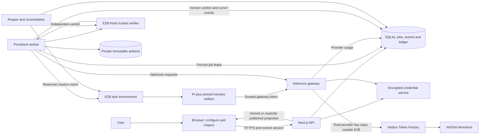
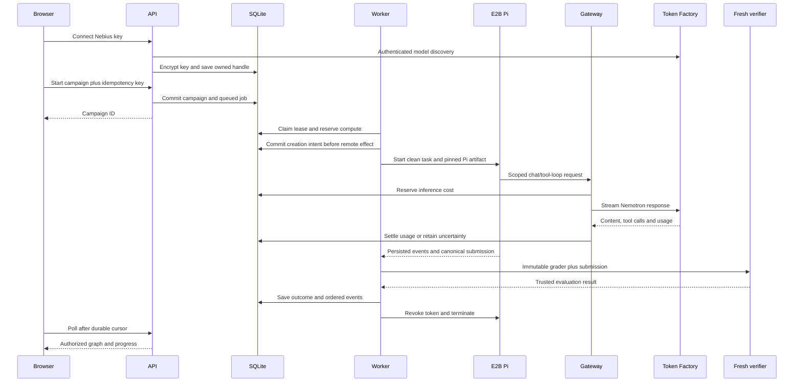

# Hosted architecture

Update, 29 October 2026: the implemented execution layer supports E2B and Token Factory Sandboxes, fixed per campaign. The [Token Factory provider design](TOKEN-FACTORY-SANDBOXES.md) describes immutable runtime images, bounded primary operations, REST subprocess control, a no-NIC guest with host-mediated inference, ownership-aware cleanup and separate compute observations. Both providers share inference accounting, harness evolution and independent grading. E2B dollar estimates do not represent Token Factory compute charges.

Status: implemented hosted modules with observed local live-pilot evidence, 28 October 2026. Real Nemotron/Token Factory inference, Pi 1.4.0 / Node v24.15.0 in E2B, a baseline and two rejected paired siblings are recorded in [Validation evidence](VALIDATION.md). The production build's public HTTPS graph and Tree/Stats controls passed browser checks. Permanent Linux deployment and a completed deep hosted lineage remain unverified. The existing local CLI remains documented in [ARCHITECTURE-LOCAL.md](ARCHITECTURE-LOCAL.md).

Read the [design specification](superpowers/specs/2026-10-27-e2b-pi-design.md) and [implementation plan](superpowers/plans/2026-10-27-hosted-pi-e2b-implementation.md) together. Supporting references are [contracts](HOSTED-CONTRACTS.md), [operations](HOSTED-OPERATIONS.md), [UX](HOSTED-UX.md) and [UML](HOSTED-UML.md).

## Product and deployment

LoopBench evolves versioned Pi harness artifacts through actual benchmark execution. NVIDIA Nemotron powers both the evaluated agent and the optimizer through Nebius Token Factory. E2B runs task attempts and independent verification. Users supply Nebius credentials. LoopBench supplies E2B compute with a cumulative USD 100 demo ceiling shared across all users and campaigns.

The observed demo runs on a local Windows host with a temporary public HTTPS tunnel. The permanent-deployment topology is one persistent Linux CPU host, a Next.js web/API process, separate Node worker/reaper processes, SQLite and private artifact storage. A TLS reverse proxy exposes the browser API and inference gateway. Pin the host's Node 24 LTS patch and existing Next.js 16.4.3 build; the actual cloud runtime is verified as Pi 1.4.0 / Node v24.15.0. No GPU is required on this host.

This topology avoids an ephemeral web-function filesystem and request-duration coupling. SQLite's durable queue and transactional ledger are sufficient for the bounded single-host pilot. PostgreSQL and object storage are future multi-host adaptations. Redis, Kubernetes and an external workflow service are not first-release requirements. The hosting vendor is a deployment choice; the host must have persistent disk, public HTTPS and reliable process supervision.

E2B cannot call a gateway bound only to the developer's localhost. Local development with real E2B needs an explicitly configured reachable HTTPS gateway. Keep the existing local-only application on loopback unless the hosted identity and publication boundaries are enabled.

## System context

## Module ownership

These implemented modules own the listed boundaries. HTTP handlers validate and delegate; the separate durable worker runs the evolution loop. Module presence is distinct from the remaining deployment and live-evidence limits recorded above.

| Boundary              | Files                                                                        | Responsibility                                                      |
| --------------------- | ---------------------------------------------------------------------------- | ------------------------------------------------------------------- |
| Domain/config         | `hosted/schema.ts`, `hosted/config.ts`                                       | Schemas, identifiers, limits and feature gates                      |
| Storage               | `hosted/database.ts`, `hosted/migrations/001-initial.sql`, `hosted/store.ts` | Transactions, ownership, persistence and projections                |
| Identity              | `hosted/auth.ts`                                                             | Signed opaque browser session and origin checks                     |
| Credentials           | `hosted/credentials.ts`                                                      | Encryption, credential handles, revocation and key-version metadata |
| Model catalog         | `hosted/models.ts`, `hosted/pricing.ts`                                      | Catalog normalization, verified capabilities and rate snapshots     |
| Money                 | `hosted/budget.ts`                                                           | Atomic admission and settlement across compute/inference accounts   |
| Work                  | `hosted/jobs.ts`, `hosted/events.ts`                                         | Queue leases, fencing, idempotency and ordered events               |
| E2B                   | `hosted/e2b.ts`, `hosted/sandboxes.ts`                                       | Transport, creation intents, network policy and cleanup             |
| Pi                    | `hosted/pi.ts`, `hosted/pi-events.ts`, `hosted/harnesses.ts`                 | Versioned artifacts, agent configuration and event parsing          |
| Evaluation            | `hosted/task-workspaces.ts`, `hosted/verifier.ts`                            | Clean task state, output extraction and trusted grading             |
| Gateway               | `hosted/gateway.ts`, `hosted/gateway-tokens.ts`                              | Scope validation, inference reservation, streaming and usage        |
| Evolution             | `hosted/evolution.ts`, `hosted/worker.ts`, `hosted/reaper.ts`                | Finite scheduling steps, frontier search and recovery               |
| Artifacts/publication | `hosted/artifacts.ts`, `hosted/publication.ts`                               | Private files, authorized downloads and sanitized public snapshots  |
| HTTP                  | `app/api/hosted/**`, `app/api/inference/v1/chat/completions/route.ts`        | Browser/control/gateway boundaries                                  |
| Browser               | `app/setup/**`, `app/experiments/**`, `components/hosted/**`                 | Connect key, configure run, inspect graph and control campaigns     |

Keep the local executable adapter registry local-only. A hosted visitor cannot register a shell command for the API host. Treat `core/evolution.ts` as a source of tested policy decisions, not a hosted request handler or durable distributed loop. Reuse pure policy and curriculum behavior only after tests pin their semantics.

## Identity and credentials

A signed opaque browser session owns private records through `owner_scope`. All private queries include it; foreign and unknown IDs return 404. This pilot identity is not a verified user account. Losing the cookie loses access unless a later recovery flow is implemented. Global budgets and per-credential/IP admission limits remain necessary because users can create new sessions.

Nebius keys are encrypted with a deployment key held outside SQLite. Jobs carry credential IDs, never secret values. The browser receives only redacted connection status. The platform E2B key stays in backend configuration. Keys never enter URLs, logs, Pi sessions, graph records or reusable snapshots.

Pi receives a short-lived gateway token scoped to owner, campaign, attempt, model, lease generation and expiry. The gateway inserts the actual Nebius key, permits only approved inference routes and counts every provider request. It is not an arbitrary URL proxy. Revoking a credential also revokes its gateway scopes and stops additional model requests.

Private results remain private after completion. Publishing creates a sanitized allowlisted snapshot. The old global JSON APIs must be loopback-only, disabled in hosted mode or restricted to selected published archive data. Do not expose all historical files merely because the application is deployed.

## Harness ancestry and execution ancestry

The graph node is a **harness version**, not a sandbox or one completion. It identifies a reusable artifact, parent, model, benchmark revision, hypothesis and measured verdict. Each version has multiple task attempts. Each attempt can have an agent sandbox and a separate verifier sandbox.

Candidate and fresh parent reruns use identical model, suite and clean task state. A new task starts from its own baseline repository, never the previous task's solved filesystem. A new generation inherits the harness artifact and measured lessons, not a task-specific solution patch. Changing the evaluated model creates a new comparison identity.

Proposals are hypotheses shown as a text list. They become measured graph records only when actual execution starts. Ties, regressions, incomplete attempts and infrastructure failures remain visible. No fixture or prepared tree is inserted into the hosted catalog.

## Request and execution sequence

## Evolution and benchmark policy

1. Run a real baseline with Pi filesystem/tool use.
2. Rank eligible current-suite nodes by measured score and recency. Expose up to beam width 2.
3. Select `min(6, 2 + distinct failed task IDs)` from frontier and recent same-suite paired evidence, unless a fixed 2-6 width is requested.
4. Have Nemotron propose a complete distinct sibling set with actual learning references. Validate the entire set before execution.
5. Admit the full round's estimated inference and compute envelope. Execute under the global two-sandbox limit, including setup and verifiers. Pending siblings survive checkpoints.
6. Accept only a strictly better complete paired score. Infrastructure errors invalidate comparison; they cannot become a zero-scoring parent.
7. After a complete sibling round and mastery, generate independently verified harder cases, retaining the existing regression policy. Measure the unchanged champion as an explicit challenge baseline.
8. Continue without a fixed generation ceiling until pause, stop or a resource/provider checkpoint. Neither a perfect score nor exhausted allowance means completed continuous evolution.

The first hosted task set is the existing six adversarial function contracts, rendered as small Pi workspaces with canonical output `src/solution.cjs`. Public smoke tests help the agent. Hidden acceptance cases live only in a fresh verifier. This is function implementation through a real agent, not a SWE-bench or repository-repair result. Richer repair benchmarks follow the full pipeline's live validation.

The trusted verifier receives immutable evaluator bytes and the extracted submission in a new E2B environment without inference credentials or the agent's modified workspace. It does not trust edited public tests, package scripts, dependencies or claimed results. Canonical extraction rejects symlinks, path escapes and grader/harness modifications.

## Budgets and finite lifetimes

Use integer micro-USD internally and decimal-string micro-USD at HTTP boundaries. Parse provider decimal rates exactly and round reservations upward. Compute is constrained by both platform and campaign accounts but is not added twice to total provider spend.

| Limit                      | Proposed value  | Meaning                                                          |
| -------------------------- | --------------- | ---------------------------------------------------------------- |
| Platform demo ceiling      | USD 100         | User-selected cumulative total, no automatic reset               |
| Ordinary compute admission | USD 90          | USD 10 held for uncertainty/reconciliation                       |
| Initial campaign compute   | USD 5           | Proposed default for a full wide round, not a per-call allowance |
| Initial campaign inference | USD 0.20        | Proposed user-funded default                                     |
| Operator inference ceiling | USD 0.50        | Proposed first-pilot setting                                     |
| Active sandboxes           | 2 globally      | Includes agents, verifiers and setup                             |
| Sandbox lifetime           | 600 seconds     | Reserved before create or extension                              |
| Job lease / heartbeat      | 60 / 15 seconds | Fenced durable ownership                                         |
| Reaper sweep               | 15 seconds      | Reconcile abandoned resources                                    |

Admission atomically enforces `settled estimate + outstanding reservations + requested reservation <= allowed amount` across all applicable accounts and active slots. Charge time spent waiting for models. Admit extensions, resumes and new environments separately. Unknown create/termination/usage results retain their envelopes. Missing applicable prices block admission instead of becoming zero cost.

Each actual Pi model turn, retry, compaction and optimizer request has a separate inference reservation. Costs use timestamped pricing snapshots and returned usage; they remain estimates rather than invoices. E2B account spending limits supply a second control whose scope/reset/enforcement must be confirmed. See [official billing](https://docs.e2b.dev/billing).

## Network and recovery

Derive a pinned template from the official `pi` template if needed. Prepare dependencies before introducing gateway tokens. During agent execution allow only the configured gateway/artifact endpoints; deny all other egress. Domain rules require deny-all and apply to HTTP(S). Verification has no network requirement. See [official Pi guide](https://docs.e2b.dev/agents/pi) and [network control](https://docs.e2b.dev/network/internet-access).

Commit a unique creation intent, worker fence, maximum lifetime and reservation before calling E2B. Attach intent metadata. If the create response is lost, reconcile by that identity before any replacement. Disable unverified retries for non-idempotent creation. The first release creates siblings individually from clean template/snapshot state; batch fork optimization is deferred until per-child recovery is verified.

Persist sandbox/process IDs and bounded log files. Reconnect to existing work after SDK loss; do not spawn a new attempt blindly. A browser disconnect does not affect the job. A stopped campaign revokes gateway access immediately, but cleanup remains pending until its environments are confirmed stopped or expired. Stale job fences cannot renew resources, send inference or commit results. See [background recovery](https://docs.e2b.dev/commands/background).

## Migration and scope

| Existing element                                | Compatibility boundary                                                |
| ----------------------------------------------- | --------------------------------------------------------------------- |
| Local record schemas and JSON                   | Preserve immutable bytes; explicit sanitized archive publication only |
| `core/benchmarks.ts`, evaluator and definitions | Preserve source hashes; package exact bytes into fresh verifiers      |
| Curriculum/oracles                              | Reuse tested independent generation through hosted artifact storage   |
| Local runner/evolution loops                    | Preserve CLI behavior; extract pure policy behind hosted interfaces   |
| Graph layout/components                         | Reuse geometry with an owned/published presentation DTO               |
| Read-only local APIs                            | Keep local-only or serve explicit public archive in hosted mode       |
| Generic executable adapter registration         | Trusted local operator feature only                                   |
| Optional Nebius local adapter                   | Retain existing opt-in; hosted BYOK gateway is separate               |

The first release does not train model weights, generate arbitrary executable extensions, auto-promote production changes or claim distributed attestations. Data Lab lesson datasets are a separate later milestone requiring an actual dataset workflow. E2B snapshot ancestry is not proof of learned improvement.

Release gates include ownership/redaction, concurrent reservation/crash tests, remote creation/cleanup reconciliation, actual Pi/Nemotron baseline and siblings, browser reconnection and confirmed account budget controls. A passing unit fixture does not establish a live provider integration.
