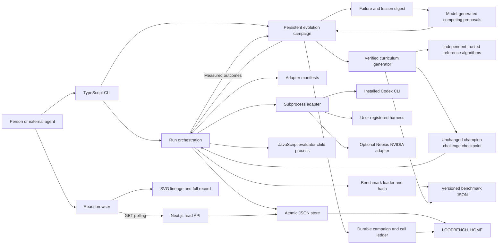

# Architecture

LoopBench is a local harness-evolution engine with an evidence browser. The CLI owns execution and writes. Evolution campaigns generate competing proposals from recorded mistakes, evaluate their branches and feed the results into later rounds. Next.js reads the same files and renders the results. The browser has no endpoint that starts model calls or accepts a node.

The working directory contains application code. `LOOPBENCH_HOME`, defaulting to the project's `.loopbench` directory, contains run state. The CLI and web server must use the same value. A different home is a different catalog.

## Component map

This is a single-machine architecture. File storage is deliberate for a small local tool: users can inspect every result, no database service is required, and CLI activity can be reflected immediately. A multi-user hosted service would need authorization, durable shared storage, a queue, isolated workers and explicit ownership. Deploying this directory unchanged to a serverless host would not provide those guarantees.

## Modules and ownership

| Module | Responsibility | Allowed effects |
| --- | --- | --- |
| `core/types.ts` | Zod schemas and shared record types | None |
| `core/store.ts` | Data-home resolution, tree identity, node persistence, adapter registration, tree grouping | Local file reads and atomic replacements |
| `core/adapters.ts` | Spawn a configured process, deliver one request, validate one response, enforce timeout/output bound | Process execution |
| `core/benchmarks.ts` | Parse/hash benchmarks and invoke evaluation | Benchmark reads, evaluator subprocess |
| `benchmarks/evaluate.mjs` | Load a generated function and compare test outputs | Bounded JavaScript execution in a child |
| `core/runner.ts` | Validate run identity, execute candidate and paired parent, determine verdict, preserve progress | Calls the modules above |
| `core/evolution.ts` | Build failure digests, validate model proposals, select parents, persist continuous search and advance verified challenge levels | Proposer and runner calls |
| `core/curriculum.ts` and `core/curriculum-oracles.ts` | Generate fresh challenge levels, retain anchors and known failures, calculate independently checked answers | Local immutable benchmark files; no model inference |
| `core/campaigns.ts` | Campaign progress, proposed changes, call accounting and continuation evidence | Atomic campaign records |
| `cli/main.ts` | Parse commands and expose runner, adapters and records | Terminal output and authorized writes |
| `adapters/codex-cli.mjs` | Translate task protocol into Codex CLI invocation and usage | Installed CLI process |
| `adapters/codex-proposer.mjs` | Translate evidence and proposal contract into a dedicated Codex inference call | Installed CLI process |
| `integrations/nebius-adapter.ts` | Optional NVIDIA code generation or proposal JSON, with explicit paid opt-in and limits | One bounded HTTP inference per invocation |
| `app/api/trees/**` | Read current tree/catalog state | Read-only local store access |
| `app/api/campaigns/route.ts` | Read current durable campaign records | Read-only local store access |
| `components/**` | Refresh state, filter trees, draw lineage and inspect evidence | Browser state and GET requests |

## Record identity

`RunConfig` names `adapterId`, `domain`, `model`, `harness`, `benchmarkId`, `benchmarkHash`, the resolved `benchmarkPath`, optional `lineageId`, and string-valued `settings`. The benchmark hash includes the definition and evaluator/controller source digests. Ordinary finite experiments derive tree identity from `[domain, model, harness, benchmarkHash]`. A continuous campaign instead keeps one validated lineage identity across curriculum revisions. Adopting an existing measured tree retains its identity and immutable history. Domain, model, harness and parent lineage still have to match. A challenge checkpoint makes the changed test set explicit rather than claiming cross-benchmark improvement.

A node has its own ID, optional `parentId`, `treeId`, creation/completion times, hypothesis, configuration fingerprint, task results, score, comparison and error. Continuous nodes also record `curriculum.level`, `curriculum.benchmarkId` and `curriculum.benchmarkHash`. An unchanged-champion checkpoint has `event="challenge"`, `status="baseline"`, a parent edge to the previous champion and no paired comparison. The fingerprint covers the manifest, harness label, settings, readable files supplied as absolute adapter arguments, Node version and, for Codex, its reported CLI version. It detects these forms of drift; it is not a complete executable/dependency snapshot. Each task records its output, pass/fail, duration, error and nullable token/cost fields. Unknown usage is `null`; it is not zero.

Evolution nodes also have `learning`: actual `learnedFrom` node IDs, model diagnosis, concrete change, falsifiable prediction, proposer identity and round. These fields preserve the reason for an intervention. They are not measurements. The measured task results and comparison establish its outcome.

Adapter identity is kept on the run configuration. It is not part of tree identity. A candidate can change adapters while keeping the same domain/model/harness/benchmark tree. The paired rerun uses the parent's original adapter and settings and refuses a changed parent adapter manifest. Inspect both configurations when interpreting a comparison or a tree with multiple roots.

## Persistence and freshness

Nodes live in `.loopbench/nodes/<id>.json`; registered adapters live in `.loopbench/adapters/<id>.json`; campaigns live in `.loopbench/campaigns/<id>.json`. A write first creates a temporary sibling file and then renames it into place. Readers therefore avoid observing partially written JSON. One node is updated while it is running, with prior task entries retained. After it completes, the store refuses changes to that node's evidence and identity.

Per-node files let unrelated runs write distinct paths. Atomic rename does not supply a transaction across several files, a distributed lock, or recovery from disk loss. A killed runner can leave a node in `running`. Do not silently turn that record into a successful result.

A campaign has a local exclusive worker lock containing the process ID. Every existing lock is refused, including a stale lock. After a crash, the operator must confirm that its worker stopped and explicitly remove that campaign's stale lock before resuming. The engine does not probe a PID and automatically replace a lock, which would introduce a recovery race. Before every proposer, baseline, parent or candidate adapter invocation, the engine saves a `reserved` call entry. The persisted invariant is `callsUsed === calls.length <= maxCalls`. Reserved attempts survive a crash and remain spent rather than becoming free retries.

Continuous campaigns can resume resource checkpoints in the same lineage, with an explicit additional-call grant when needed. Pause and stop requests use a separate control file so they cannot overwrite the worker's ledger. Recovery marks interrupted reservations and its incomplete active node failed; a reserved attempt does not become a free retry. Existing locks are never replaced automatically. Legacy finite campaigns retain their terminal completion and saturation behavior.

Recognized provider usage/rate limits pause continuous execution before another sibling starts. Pending proposals and failed attempts remain on disk. Explicit resume may make another quota-failed proposer attempt, recorded as a new spent call, while invalid or interrupted proposer responses still fail closed. There is no background provider retry.

The read API groups nodes by `treeId`, orders nodes by creation time and trees by update time. Missing data directories yield an empty catalog. Invalid JSON or schema-invalid files are errors; the UI must not replace them with seeded success. Client polling requests fresh data approximately every two seconds and reconciles the selected node by ID.

## Execution and trust boundaries

The subprocess adapter receives the task prompt, model, harness, settings and instructions. Benchmark cases remain in the evaluator path rather than the adapter request. Adapter stdout must contain one JSON response. Diagnostic text belongs on stderr. The response's `output` is code to test, not a claimed score to trust.

Evaluation uses Node.js permission flags, read access limited to the evaluator file, a sanitized environment, a fifteen-second process timeout, a 64MiB V8 heap setting and one-second `node:vm` execution timeouts. Test arguments are parsed inside the VM's realm. Tasks marked `nonMutating` compare argument values before and after invocation. Named cases provide contract diagnostics. A returned evaluator result can mark bad code or a VM timeout as a task failure. Evaluator startup, exit, outer process timeout or invalid-protocol errors propagate to a failed evaluation rather than lowering a parent score and manufacturing an improvement.

These controls reduce ordinary mistakes and accidental exposure. Node's VM and these process limits do not establish a strong security boundary for hostile code. A registered adapter is an executable chosen by the local user and inherits process permissions/environment. The Codex adapter requests read-only operation, but this is not a substitute for a hardened container or VM around every generated program. Docker-backed hostile-code execution is not implemented in this build.

## The implemented feedback loop

Each round reads the matching lineage, restricts eligible nodes to the current benchmark hash, ranks completed scored nodes by score and then recency, and exposes up to `beamWidth` eligible parents to the proposer. Recency breaks ties so a useful recent descendant can remain in the beam. The engine adaptively selects 2-6 siblings from measured failure evidence, unless `--branches N` fixes a count in that range. The proposer chooses one shared parent and supplies exactly that many distinct sibling interventions. The count is a per-round contract, not a lifetime graph limit. The adaptive rule is `min(6, 2 + distinct failed task IDs)` over the beam frontier and latest completed round on the current suite, including paired-parent failures. `options.adaptiveBranches` records the policy and `campaign.branches` records the selected width. A saved proposal set keeps its width across pause/resume.

In continuous mode, the request includes public task prompts and a bounded window of eligible parents, nearby ancestry and recent node evidence with output excerpts, diagnostics, paired parent failures and recorded lessons. Aggregate archive summaries retain counts and recurring lessons from older failures and strategies; the raw history stays on disk. Serialized context is limited to 120,000 characters rather than growing with campaign depth. It excludes expected test values and evaluator cases. Validation requires known learning references, the chosen parent in every reference set, and at least one visible measured mistake reference whenever such evidence exists. A proposal cites actual relevant records rather than every archived ID. It rejects duplicate sibling instructions and an instruction change already evaluated from that parent. It does not mechanically prove that the model's explanation is correct or that instructions cannot encode a bad strategy; the next real execution tests the proposal.

Validated proposals are persisted before sequential paired evaluation. The next generation consumes measured siblings and their mistakes. Continuous mode ignores finite generation/candidate ceilings. A perfect suite advances to an independently checked curriculum level only after a complete 2-6-sibling round on that suite. This also applies to an already perfect root or challenge checkpoint. The engine then measures the unchanged champion on the new level before its next sibling round. An insufficient allowance creates `waiting_budget`, preserving the search for explicit continuation. A new challenge checkpoint is not an accepted harness improvement. Finite mode remains available for bounded software checks and demonstrations.

`maxCalls` bounds adapter invocations controlled by this process. The ledger includes proposal calls, new baseline calls, challenge checkpoints and both sides of every candidate comparison. Opaque adapters such as Codex can make their own model/tool calls; neither this count nor a reported cost subtotal is an account-wide spending guarantee.

The default Next.js commands bind to `127.0.0.1`. This matters because the API exposes local experiment outputs. Do not expose it publicly without adding access control and considering whether prompts or outputs contain private data.

## Verified challenge generation

`core/curriculum.ts` generates 48 new cases per level for the six adversarial task contracts. Expected answers come from `core/curriculum-oracles.ts`, not the proposer or evaluated model. Generation verifies the base cases and permanent failure pins against those reference algorithms. Immutable artifact identity includes the original benchmark hash, generator and oracle source hash, seed, level and pins. The suite retains all 64 base cases, level-one anchors, the latest eight complete levels and all identified historical failing checks. Case complexity has execution safety bounds, while fresh deterministic inputs continue at later levels. Unsupported contracts or failed verification produce `waiting_challenge`. See [CONTINUOUS-EVOLUTION.md](CONTINUOUS-EVOLUTION.md).

## Acceptance authority

A root is a measured `baseline`. An unchanged-champion challenge checkpoint is also a `baseline`, with a parent edge and explicit challenge metadata; its score cannot be compared directly with a different curriculum level. A child reruns the parent and candidate on the same benchmark and is `accepted` only when its score exceeds that fresh parent score. Ties and regressions are `rejected`; infrastructure or adapter failures become `failed`. All remain in the tree.

The comparison stores the fresh parent task results and both scores. This is one local paired comparison. It has no verifier keys, public ledger, repeated-run statistics, independent execution claim, automatic deployment, or production promotion. The UI must use that exact language.

See [UML.md](UML.md) for record relationships and sequences, [EVOLUTION.md](EVOLUTION.md) for the learning model, and [HOW-IT-WORKS.md](HOW-IT-WORKS.md) for the operator flow.
