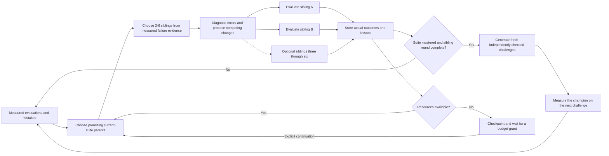

# Continuous evolution

LoopBench's continuous mode has no programmed generation ceiling. Every evolution round proposes 2-6 distinct sibling experiments, measures them and retains unsuccessful branches. New campaigns default to adapting the count to measured failure evidence. An explicit `--branches N`, from 2 through 6, fixes the count. A perfect suite must still complete a sibling round on that suite before the engine can advance its challenge. Reaching 100% does not finish the search.

## Search and challenge feedback



Each admitted sibling round contains 2-6 real competing experiments, including at an already perfect baseline. The engine validates the complete proposal set before evaluating it; pending proposals survive a pause so resumption can finish the round. Width comes from those competing experiments. Depth comes from using the measured descendants as parents for later changes. Neither dimension is filled with prepared example nodes. A model proposal is a hypothesis; only execution creates a measured result.

The adaptive rule starts at two siblings and adds one for each distinct failed task ID found in the current beam frontier or latest completed round on the current benchmark, capped at six. It includes failed tasks from fresh paired-parent evidence. Scores and failures from other benchmark hashes do not set the width. An explicit `--branches N` disables adaptation and fixes N within 2-6.

The selected width is persisted as `campaign.branches`; `options.adaptiveBranches` records whether it can change on later rounds. Once a round has valid saved proposals, resume uses that exact sibling set rather than recalculating its width.

## One lineage, several benchmark levels

A continuous campaign keeps a stable `lineageId`. Starting from a previous measured version adopts that tree's identity, preserving its existing nodes. Later curriculum levels append to the same graph instead of creating unrelated three-node trees. Historical checkpoint chains remain immutable even when they predate the required sibling-round policy; new execution follows the current policy.

Each node identifies the benchmark revision that actually evaluated it. After a completed sibling round establishes or retains mastery on the current suite, advancing a challenge adds a real checkpoint of the unchanged champion on the harder test set. That new level also receives its own sibling round before another transition, even when its checkpoint scores 100%. That checkpoint is labelled as a challenge transition, not an accepted harness improvement.

Within a challenge level, a proposed child and its parent are both executed against the same cases. Their paired delta is meaningful for that revision. Percentages from different challenge levels are shown separately. Passing 70% of a harder suite is not automatically worse than passing 100% of an easier suite.

## Where new challenges come from

The coding curriculum generates deterministic cases for the six supported contracts using independently validated reference functions. The proposer does not supply the expected answers. Generation needs no model call. Recorded metadata identifies the level, seed, retained levels, source digests and case counts.

The active suite retains the original regression cases and known failing cases. It also includes anchor cases and a rolling window of recent generated levels. The window bounds routine evaluation work while preserving the concrete mistakes the search has already found. The complete experiment history remains on disk.

New levels vary input structure, combinations and complexity within the evaluator's resource limits. This supplies continuing verified challenges in the supported task families. It does not claim that those families cover every software-engineering problem or that every new level must defeat the current model.

## Resource checkpoints

`maxCalls` is an allowance for adapter invocations. It includes the proposer, parent reruns, candidate runs and challenge checkpoints. It is not an exact provider-billing cap because an external CLI can make internal requests.

For a six-task suite, a round with B siblings needs `1 + 12 × B` adapter invocations, from 25 for two siblings to 73 for six. A baseline or unchanged-champion challenge checkpoint needs six more. The admission check uses the selected round width and never cuts the sibling count below two to fit an allowance.

When the allowance cannot cover the next operation, a continuous campaign records `waiting_budget`. It retains its lineage, proposals, lessons and spent calls. An explicit grant can continue that same campaign. A budget grant never happens automatically. Paid Nebius inference still requires its separate opt-in and price/token limits.

The operator can pause or stop a campaign. Infrastructure failure and an unavailable validated curriculum produce an explicit checkpoint or error. Continuous search does not guarantee that every proposal improves the harness, and it does not relabel a regression as progress.

A recognized provider usage or rate limit pauses continuous execution before starting another sibling. The failed evaluation and its spent attempts remain recorded; unstarted proposals survive. After inference access returns, explicit `resume` continues those pending proposals. If the proposer itself reached the limit, explicit resume makes a new proposer attempt while retaining the old failed attempt and charging the call ledger. Invalid proposal JSON and interrupted calls remain fail-closed, and no retry happens in the background.

## Operator workflow

```powershell
npm run cli -- evolve --continuous --adapter codex-cli --domain coding --model MODEL --harness codex-cli --benchmark coding-adversarial-v1 --beam-width 2 --max-calls 80
```

Use an available model in place of `MODEL`. Omitting `--branches` enables adaptive 2-6 sibling selection. For a fixed-width experiment, append `--branches 3`, or another integer from 2 through 6. The CLI defaults to continuous mode; use `--finite` explicitly for bounded rounds. Add `--parent NODE_ID` to continue a measured tree. The command uses actual model inference through the selected adapter. Inspect the saved campaign and use an explicit grant to continue a budget checkpoint:

```powershell
npm run cli -- campaign CAMPAIGN_ID
npm run cli -- evolve --resume CAMPAIGN_ID --grant-calls 80
```

See [EVOLUTION.md](EVOLUTION.md) for learning records, [ARCHITECTURE.md](ARCHITECTURE.md) for boundaries, and [VALIDATION.md](VALIDATION.md) for observed results and remaining verification limits.
