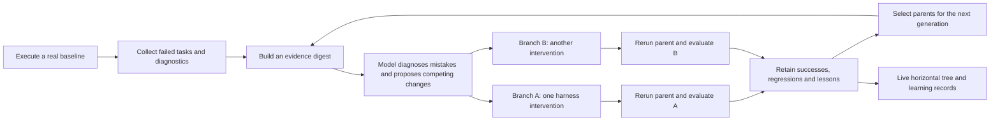

# Evolving through mistakes

An evolution tree is a search history. Several children test different explanations for a parent's failures. Later generations use the results of those competing experiments to decide which harness changes to try next. Drawing branches without this feedback would only make the history look more complicated.

## The loop

Continuous execution has no fixed generation ceiling. A resource allowance controls adapter invocations and creates a resumable waiting checkpoint when depleted. A perfect suite advances the curriculum only after completing a sibling round on that suite. A baseline or challenge checkpoint cannot skip the competing experiments. Legacy finite campaigns retain their configured round/candidate limits. Each candidate is evaluated through the same runner as a manual experiment. The proposer can suggest a change; it cannot supply a score or declare that its own proposal improved the harness. See [CONTINUOUS-EVOLUTION.md](CONTINUOUS-EVOLUTION.md).

## What the agent learns from

The proposer receives public task specifications, previous harness instructions, task pass/fail diagnostics, actual generated outputs, measured comparisons and lessons from rejected attempts. Continuous requests contain a bounded evidence window and compact archived summaries, not the entire raw history on every invocation. Exact records remain on disk. Learning references identify the parent and relevant actual evidence, including a visible measured mistake when one exists. Expected answers and evaluator cases are kept out of the proposal request. Cases remain public source files, so this is separation of the input contract rather than a claim that a determined local program cannot read them.

Every proposed candidate records:

| Field | Meaning |
| --- | --- |
| `parentId` | The harness version being changed and compared |
| `learnedFrom` | Prior node IDs whose results informed the change |
| `diagnosis` | What the proposer thinks caused the observed mistake |
| `change` | The harness intervention intended to address it |
| `prediction` | An expectation that the next execution can contradict |
| `hypothesis` | The short explanation used on the graph |
| `instructions` | The actual candidate harness instructions |
| `round` | Which search generation proposed it |

The diagnosis is a model's hypothesis. The task results are observations. Keeping them separate lets a user see when an attractive explanation failed in practice.

## Branches and generations

Every evolution round contains 2-6 distinct sibling experiments. Continuous mode adapts their number to measured failure evidence by default; `--branches N` fixes it for any integer from 2 through 6. The engine refuses a proposal set that does not match the selected width. A budget checkpoint or pause preserves pending work rather than shrinking a round to one child. Siblings share a parent so their interventions can be compared against the same starting configuration. Later rounds select promising completed evaluations on the current benchmark hash. They carry recent relevant mistakes and compact archived lessons forward, including rejected branches. The sibling count and `beam-width` control a round and eligible frontier, not the lifetime width or depth of the tree.

An evaluated rejected version may still contain a useful partial strategy. Its evidence can inform another proposal even when that proposal branches from a different parent. The structural parent edge and the `learnedFrom` references express these two different relationships.

Each candidate re-evaluates its parent with the parent's original adapter and settings. Acceptance requires an actual positive task-pass-rate delta in that paired evaluation. Ties are retained as rejected experiments. Infrastructure failures stop evaluation and cannot count as lost tasks that make another version appear better.

## Reading the tree

Read from left to right. Each column is another parent generation. A column can contain an explicit unchanged-champion challenge baseline as well as harness changes; counting nodes does not count learned upgrades. Branches show alternatives, not predetermined stages. Select a node to inspect the mistake, proposed lesson, concrete instructions, task evidence and measured outcome below the graph. A failed hypothesis remains available to the next round and to the person inspecting the experiment.

The viewer polls saved evidence. It never adds example branches, makes a pending node pass after a timer, or substitutes a staged success when a provider is unavailable.

## Benchmark choice

`coding-functions-v1` is a three-task smoke check. A capable model can saturate it, so it is a poor choice for demonstrating learning. `coding-adversarial-v1` exercises six more demanding function contracts: strict CSV, atomic JSON Pointer patches, exact decimal sums, weighted LRU behavior, time-zone interval handling and dependency layers. Named diagnostics make mistakes actionable while keeping expected values out of model requests.

The verified curriculum adds 48 fresh cases per level with independently computed expected answers. It retains the 64 base cases, level-one anchors, the latest eight complete levels and all identified historical failing checks. It supports only contracts with trusted generators and reference algorithms; otherwise the campaign enters `waiting_challenge`.

A 100% result means the current test set found no remaining error. Continuous mode first completes a 2-6-sibling round on that suite, including when a root or challenge checkpoint was already perfect. It then generates and verifies the next challenge, measures the unchanged champion on it and continues the same lineage. The challenge node has `event="challenge"`, status `baseline`, unchanged instructions and a parent edge to the prior champion. Its new score is not a delta against the old suite. Subsequent acceptance requires a fresh paired comparison on the same new benchmark hash. It retains regression evidence instead of weakening a baseline or inventing a failure. No campaign can promise that every proposal will improve.

## Scope

This implementation evolves harness instructions and recorded configuration through actual model proposals and executions. Arbitrary repository patching, dependency installation, distributed verifier signatures and production deployment remain separate work. The current evaluator is a bounded local process, not a hardened environment for hostile code. The included benchmarks measure function contracts rather than a broad software-engineering leaderboard.

See [HOW-IT-WORKS.md](HOW-IT-WORKS.md) for the adapter contract, [ARCHITECTURE.md](ARCHITECTURE.md) for persistence and trust boundaries, and [IMPLEMENTATION.md](IMPLEMENTATION.md) for verification and commands.
