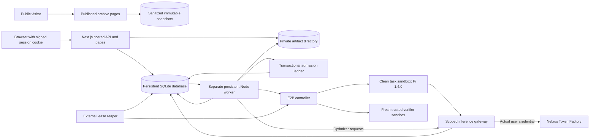
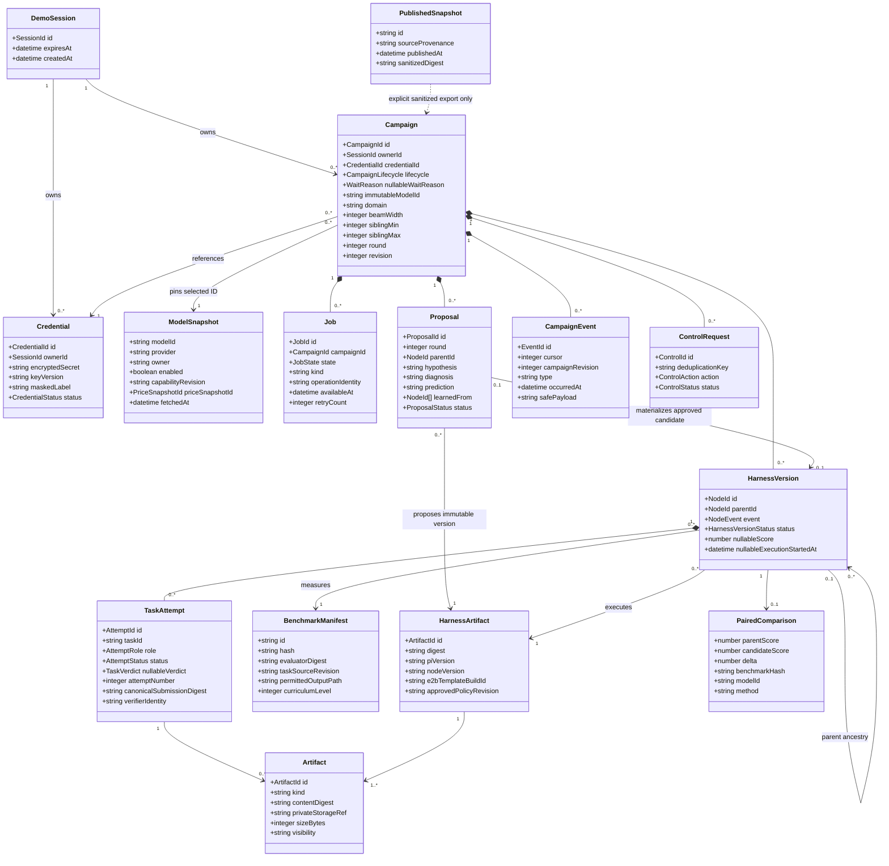
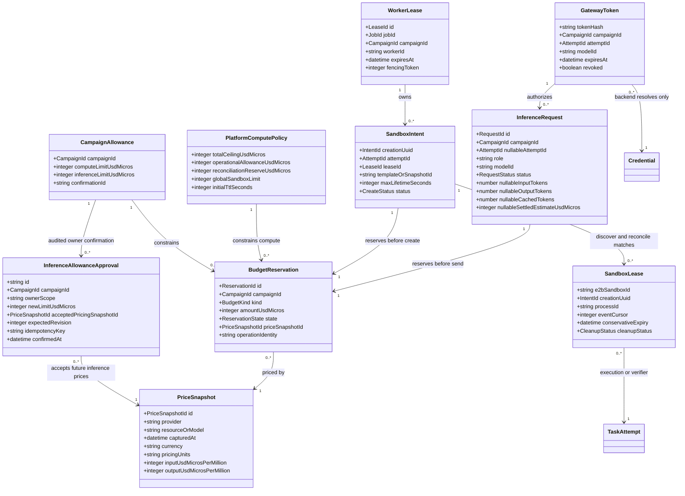
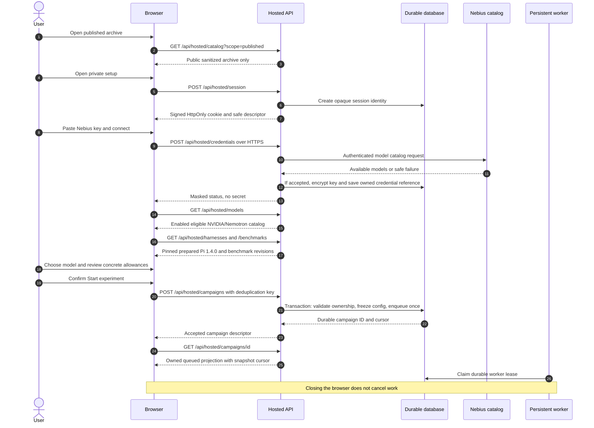
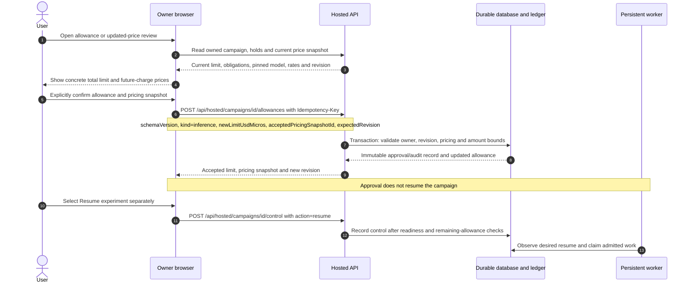

# Hosted UML and execution models

Status: planned, documentation only. These diagrams describe proposed records and services for the first hosted E2B/Pi pilot. They do not describe classes already present in the local code, implemented API routes or verified live provider behavior.

See [the hosted architecture](./ARCHITECTURE-HOSTED.md), [the hosted UX](./HOSTED-UX.md), [the E2B/Pi design](./superpowers/specs/2026-10-27-e2b-pi-design.md) and [the local implementation UML](./UML.md).

## Deployment and trust boundaries



The persistent CPU host serves Next.js and runs a separate worker and reaper. E2B supplies task isolation, and Nebius supplies inference. No local GPU is required. The gateway must have a publicly reachable HTTPS origin that E2B can access. A localhost web server is not a cloud sandbox's inference endpoint.

Only the backend/controller receives the platform E2B key. Only the gateway resolves the user's encrypted Nebius credential. A task receives a revocable scoped gateway token, never either provider credential or an E2B controller token. The trusted verifier receives the immutable evaluator and canonical submission, with no inference token or inherited agent filesystem. Deny-by-default execution egress permits the gateway and explicitly required first-party artifact endpoints after task dependencies are prepared.

## Durable domain records

These are conceptual persisted data types. Implementation should encode lifecycle variants and identifiers explicitly rather than allow contradictory optional fields. Secret material is separated from browser/API projections.



The initial fixed values are domain `coding`, adaptive sibling width 2-6, beam width 2 and actual Pi version 1.4.0. The benchmark starts with the existing six `coding-adversarial-v1` contracts in clean workspaces, outputting `src/solution.cjs`. The target model is selected from the enabled eligible NVIDIA/Nemotron server catalog and is immutable within the lineage. The optimizer uses that same model in the first pilot.

Select the cheapest compatible enabled Nemotron by the review's uncached input plus estimated output cost, displaying both per-million-token rates and price capture time. The compatible tie-break preference is `nvidia/Nemotron-3_5-Lightning` after tool/JSON verification. This is a selection policy over current prices, not permission to hardcode stale rates or fall back automatically to a larger model. A later price change requires a revised estimate and owner reconfirmation before future charged admission; the model ID stays pinned. The user's USD 5 Nebius account funding is separate from either campaign allowance.

`HarnessVersion` is the canonical hosted record behind a graph node. Its statuses are `proposed`, `evaluating`, `baseline`, `accepted`, `rejected`, `failed` and `cancelled`. A stored proposed version remains a hypothesis-list entry; the graph projection includes it only after actual evaluation execution is recorded. A baseline/challenge execution can have no proposal. Each measured node links candidate and paired-parent task attempts, plus retry history. Sandbox IDs and task attempts are not graph versions. `event=challenge` measures the unchanged harness on a new suite, uses status `baseline` after valid evaluation, and has no paired cross-suite delta.

The UI derives a measurement label from the version's terminal status. A running/failed execution's nullable score is not zero. `accepted` requires positive measured paired delta for the same model, benchmark and evaluator. A task attempt's separate verdict is `pass`, `fail` or null; infrastructure failure supplies no valid task judgment and cannot manufacture a low paired score.

## Ownership, leases and reservations



An intent normally has one sandbox. `0..*` records the reaper's ability to discover every matching provider environment after an ambiguous response. Unexpected duplicates are accounted for and terminated, never treated as free capacity. A unique creation-intent UUID, durable lease/fencing token, database constraints and provider metadata bind each logical operation to one current owner. A worker must not blindly recreate an uncertain intent.

All persisted money uses nonnegative integer USD micro-units. Displayed dollar decimals are formatting, not floating-point ledger arithmetic. Nullable usage/cost means unknown; it never becomes a zero charge by default.

Proposed compute defaults are USD 100 total for the entire platform, USD 90 operational admission allowance, USD 10 held for uncertainty/reconciliation, USD 5 per whole campaign, two globally active sandboxes including setup/verifiers, and 600 seconds initial provider-enforced lifetime per admitted attempt. These are conservative pilot settings. The user's inference allowance is separately confirmed, initially USD 0.20 with a USD 0.50 operator ceiling and no automatic top-up.

For each applicable ledger, admission requires `settled estimates + outstanding reservations + proposed reservation <= applicable allowance`. A reservation in an uncertain state remains outstanding exactly once. Compute admission also checks global active/uncertain capacity. Unknown applicable pricing blocks admission. Timeout extension, setup, verification and billable storage/network/build work need admission too. Estimates do not establish remaining provider credit or guarantee the provider invoice.

Reserve the conservative compute requirement for all 2-6 siblings before admitting a new round. Allocate that round reservation to its setup, parent/candidate task and verifier operations without counting it twice. Two active sandboxes is the execution concurrency limit, not a two-sibling limit. If the full round cannot fit the campaign/platform allowance, keep the proposals checkpointed before execution; do not reduce the round to one candidate.

## Setup and submission sequence



`GET` and `POST /api/hosted/session` inspect/create the demo session without exposing secrets. Credential mutations and campaign creation require session ownership and same-origin protections appropriate to the configured origin. Catalog authentication is not a paid completion and does not prove inference funds. A browser-supplied free-text model, upstream URL or E2B credential is never accepted.

## Inference allowance and price confirmation



The allowance body contains `{schemaVersion, kind: "inference", newLimitUsdMicros, acceptedPricingSnapshotId, expectedRevision}`. The proposed operator ceiling is `500000` USD micro-units. The new total limit cannot fall below spent estimates plus held/uncertain obligations. A same-limit confirmation can accept a refreshed pricing snapshot without granting more money. Previous obligations keep their admitted pricing basis and reservations. A stale revision or no-longer-current pricing snapshot requires an updated review and new owner confirmation.

The dedicated endpoint records approval and does not resume, create a sandbox or transmit inference. It cannot grant compute or release the platform reserve. Resume remains a separate owned control with its own idempotency key and revision check; it never hides a grant or price acceptance. Compute changes are operator-only and must retain the USD 100 total platform ceiling.

## Execution and verification sequence

```mermaid
sequenceDiagram
    autonumber
    participant Worker as Persistent worker
    participant DB as Jobs/events/ledger
    participant E2B as E2B controller
    participant Pi as Pi task sandbox
    participant Gateway as Scoped inference gateway
    participant Nebius as Token Factory
    participant Verifier as Fresh verifier sandbox
    participant UI as Owner browser
    participant API as Hosted API
    Worker->>DB: Load pinned task/harness and reserve setup/task allowance
    Worker->>DB: Commit unique creation intent, lease, TTL and metadata
    Worker->>E2B: Create clean prepared task environment, no blind retry
    alt Creation response is uncertain
        Worker->>DB: Retain full reservation and mark intent uncertain
        Worker->>E2B: Discover by creation UUID and reconcile ownership
        Note over Worker,E2B: Do not create a replacement before reconciliation
    else Creation confirmed
        E2B-->>Worker: Sandbox ID and conservative expiry
        Worker->>DB: Persist sandbox/process ownership and execution start
        Worker->>Pi: Inject approved harness and scoped token, start supervisor
        Note over Worker,Pi: Persist real graph execution; proposals alone never create nodes
        loop Each Pi request, including tool turns, compaction and retry
            Pi->>Gateway: Selected model request with scoped token
            Gateway->>DB: Validate scope and reserve maximum request cost
            Gateway->>Nebius: Forward to fixed host with actual owned credential
            Nebius-->>Gateway: Stream response and reported usage
            Gateway->>DB: Reconcile usage or retain unknown hold
            Gateway-->>Pi: Provider response, no secret
        end
        Pi-->>Worker: Bounded JSON/RPC events and runner completion
        Worker->>DB: Persist events and canonical submitted artifact
        Note over Worker,Pi: Wait for agent_settled plus runner completion
        Worker->>E2B: Revoke token and terminate task environment
        Worker->>DB: Confirm task cleanup or retain capacity/cost hold
        Worker->>DB: Reserve verifier cost and global slot
        Worker->>E2B: Create fresh trusted verifier with unique intent
        Worker->>Verifier: Immutable evaluator, hidden cases, canonical solution.cjs
        Note over Verifier: No inference credential or inherited task filesystem
        Verifier-->>Worker: Trusted bounded result and diagnostics
        Worker->>E2B: Terminate verifier and confirm cleanup
        Worker->>DB: Settle estimates, append result/event, update projection
    end
    loop Visible browser initially every two seconds
        UI->>API: GET /api/hosted/campaigns/id/events?after=cursor
        API->>DB: Authorize session and read persisted events
        DB-->>API: Ordered events and next cursor
        API-->>UI: Secret-safe owned event projection
    end
```

The sequence shows one task attempt. The same clean task and immutable evaluator are used for parent reruns and candidate attempts. Extract only `src/solution.cjs`; reject path escape, symlink output and grader/config manipulation. The API host never executes submitted code. Parent/candidate measurements feed the existing paired-comparison rules; no infrastructure error is converted into a valid low score.

After a measured baseline, the optimizer also uses the gateway with its own role/request reservations. It sees public task text and bounded actual failure/lesson evidence, not hidden expected answers. Persist 2-6 distinct sibling proposals before their execution. Finish or checkpoint all siblings before selecting the next beam or evaluating an unchanged champion on the next challenge suite. With a two-sandbox global limit, siblings can run sequentially. A verifier or setup sandbox consumes a slot too.

A snapshot and its event cursor must represent one consistent revision. Reconnect deduplicates events and resumes after the last applied cursor; cursor expiry falls back to a fresh authorized snapshot. SSE is optional later.

## Campaign lifecycle

```mermaid
stateDiagram-v2
    [*] --> queued: Durable accepted submission
    queued --> running: Lease, policy and allowance admitted
    queued --> waiting: Admission or readiness blocked; persist waitReason
    running --> waiting: Next operation blocked; persist waitReason
    waiting --> queued: Reason cleared by permitted scheduling or explicit resume
    running --> pausing: Durable pause request
    pausing --> paused: Admitted bounded work and checkpoint settle
    queued --> paused: Pause before task admission
    waiting --> paused: Owner pause request
    paused --> queued: Owner resume passes readiness and policy
    running --> running: Next admitted task or round; attempt phase changes
    running --> completed: Explicit finite campaign work finished with evidence
    queued --> stopping: Durable stop request
    running --> stopping: Durable stop request
    pausing --> stopping: Durable stop request
    paused --> stopping: Durable stop request
    waiting --> stopping: Durable stop request
    stopping --> stopped: Cancellation owned; cleanup status separately recorded
    running --> failed: Nonrecoverable execution/evaluation error
    queued --> failed: Nonrecoverable policy/configuration error
    completed --> [*]
    stopped --> [*]
    failed --> [*]
```



Campaign waiting is one persisted lifecycle variant with a required `waitReason`: `compute_budget`, `inference_budget`, `provider_quota`, `provider_auth`, `pricing_unavailable`, `global_capacity`, `reconciliation`, `credential_revoked`, `runtime_unavailable`, `challenge_required` or `operator_hold`. The UX maps these to specific messages such as `Waiting for compute`, `Waiting for inference` and `Waiting for provider`. Temporary slot availability can wake the queue without increasing an allowance. Budget exhaustion never authorizes automatic grant. Credential/allowance repair requires an explicit owner resume. Provider waiting can permit safe bounded scheduling/reconciliation; it never authorizes a blind retry of an ambiguous paid operation.

Preparation belongs to `TaskAttempt`, whose canonical states are `planned`, `admitted`, `preparing`, `starting`, `running`, `settling`, `verifying`, `completed`, `recovering`, `failed` and `cancelled`. Show that phase under the campaign's lifecycle. Do not add a campaign lifecycle variant for every task or provider phase.

`pausing` admits no new task. The current admitted task and verifier can settle within reserved limits before `paused`. A crash does not promise a resumable live Pi process; recovery first reconciles its old attempt and may start a distinct clean attempt when allowed. `stopping` revokes tokens and requests termination. `stopped`, `failed` and `completed` are terminal campaign states, but cleanup/accounting can remain `pending_reconciliation`. The reaper keeps that responsibility and reservations after the browser or worker exits.

The campaign's lifecycle is not the node verdict. A completed campaign may contain baselines, accepted, rejected and failed nodes, and a stopped campaign may retain valid measured nodes. A challenge checkpoint is a baseline for a new suite, never an accepted cross-suite upgrade.

A continuous campaign does not become `completed` when a benchmark is solved or an allowance is exhausted. It advances to an admitted challenge checkpoint or waits with its remaining work saved. Only an explicitly finite campaign uses the completion transition.

## Worker job lifecycle

```mermaid
stateDiagram-v2
    [*] --> queued: Durable job and unique operation identity committed
    queued --> leased: Transaction claims job with expiry and fencing token
    leased --> running: Current owner starts bounded job work
    running --> completed: Required durable result and checkpoint committed
    running --> waiting: Durable dependency or reconciliation checkpoint
    waiting --> queued: Dependency cleared within confirmed policy
    running --> failed: Known terminal job failure recorded
    leased --> failed: Known terminal readiness/configuration failure
    leased --> queued: Lease expires; reclaim same job and reconcile intents first
    running --> queued: Lease expires; reclaim same job and reconcile intents first
    queued --> cancelled: Campaign stop prevents admission
    leased --> cancelled: Cancellation durably acknowledged; cleanup retained
    running --> cancelled: Cancellation durably acknowledged; cleanup retained
    waiting --> cancelled: Campaign stop recorded
    completed --> [*]
    failed --> [*]
    cancelled --> [*]
```



A job is worker scheduling state, not a campaign or graph node. One campaign can require proposal, task, verifier, comparison or reconciliation work. Lease expiry reclaims the same durable job ID with a newer fencing token. It does not authorize a new copy of a remote operation. Reconcile the job's existing creation intent, sandbox/process identity and reservations before issuing any new effect, and reject stale-owner writes. If reconciliation remains ambiguous, the job can run reconciliation work while the campaign visibly waits; it cannot create an unaccounted replacement sandbox or inference request.

`completed` means that job's required result was committed. A candidate evaluation job can complete while the candidate verdict is `rejected`; an optimizer job can complete without executing a candidate. `cancelled` does not prove provider cleanup or usage settlement. Cleanup/reconciliation remains attached to owned resources and reservations, independent of both job and campaign terminal states.

## Reservation lifecycle

```mermaid
stateDiagram-v2
    [*] --> held: Commit maximum liability before paid request
    held --> held: Sent, active or stopping; liability remains reserved
    held --> released: Proven unsent or no billable operation occurred
    held --> uncertain: Lost create/stop response or unknown inference usage
    held --> settled: Usage/stop confirmed and cost reconciled
    uncertain --> held: Ownership and bounded live liability established
    uncertain --> settled: Usage reconciled or conservative expiry confirmed
    uncertain --> released: Proven no billable operation occurred
    released --> [*]
    settled --> [*]
```



`settled` records a nonnegative conservative cost estimate and releases only the unused reservation after liability is bounded. `released` means evidence establishes that the operation did not incur billable usage. It is not a synonym for timeout, client disconnect, failed HTTP response, worker crash or user cancellation. An incomplete inference stream can retain the maximum admitted request cost until reconciliation. The same hold must not be charged twice.

`held`, `uncertain`, `settled` and `released` are the canonical reservation states. Admission refusal does not create a billable reservation. Provider-operation phases such as creation requested, active, termination pending and termination uncertain belong to the sandbox intent/lease or inference-call record, not the money state. Active work retains `held` until settled; an uncertain provider outcome retains `uncertain` even if the campaign has stopped.

A lifetime extension is a newly admitted reservation linked to the original sandbox. An expired worker lease does not prove that the sandbox expired. A lost create response retains the complete reservation and logical operation identity. Finite provider timeouts plus the reaper bound recovery; uncertain ownership or expiry blocks further admission when safe cost/capacity cannot be established.

## Canonical API boundary

| Route                                   | Planned contract                                                                                                                              |
| --------------------------------------- | --------------------------------------------------------------------------------------------------------------------------------------------- |
| `/api/hosted/session`                   | Create/read the opaque signed demo session; return safe descriptor only                                                                       |
| `/api/hosted/credentials`               | Create/read masked owned credential descriptors; replace/revoke via explicit owned mutation                                                   |
| `/api/hosted/models`                    | Return current credential-backed server-filtered eligible NVIDIA catalog                                                                      |
| `/api/hosted/catalog`                   | Default `scope=published` reads sanitized real archive; authenticated `scope=mine` reads only owned summaries                                 |
| `/api/hosted/harnesses`                 | Read prepared immutable Pi/harness versions and readiness                                                                                     |
| `/api/hosted/benchmarks`                | Read allowed benchmark manifests without hidden acceptance material                                                                           |
| `/api/hosted/campaigns`                 | Submit once with deduplication key; list only owned private campaigns                                                                         |
| `/api/hosted/campaigns/[id]`            | Read the owned durable projection; an exact associated `snapshotId` may select a public sanitized snapshot                                    |
| `/api/hosted/campaigns/[id]/control`    | Record owned pause/resume/stop with `expectedRevision` and `Idempotency-Key`; no hidden budget grant                                          |
| `/api/hosted/campaigns/[id]/allowances` | Explicit owned inference-limit/price confirmation with current snapshot, revision and `Idempotency-Key`; no automatic resume or compute grant |
| `/api/hosted/campaigns/[id]/events`     | Read persisted owned events after a cursor; initial transport is polling                                                                      |
| `/api/hosted/artifacts/[id]`            | Read owned secret-safe artifact; public access requires its exact preapproved publication reference                                           |
| `/api/inference/v1/chat/completions`    | Scoped gateway request from Pi/optimizer; fixed upstream/model, budget admission and usage reconciliation                                     |

The gateway accepts its scoped authorization token rather than the browser session cookie. It is not a general proxy, user-selected endpoint or alternate route for bypassing a campaign allowance. Methods, DTOs, error codes and revision rules are specified in [the hosted contracts](./HOSTED-CONTRACTS.md). A public snapshot/artifact lookup never falls back to a private live record when its explicit publication selector is absent or invalid. Legacy local catalog routes must not read private hosted records.
