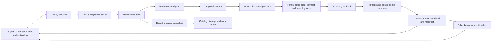

# Petri study and reconstruction boundary

Study date: 27 October 2026. Reference application: [Petri live site](https://ethonline2026-two.vercel.app/). Reference source: [Avoisavo/ethonline2026](https://github.com/Avoisavo/ethonline2026). The repository was inspected through the GitHub connector without cloning it. Source paths below refer to the inspected `main` branch, which can change.

The reverse-engineer-anything workflow routes complete source analysis through ordinary repository tools. It does not require binary analysis or REA setup. This study distinguishes live observations, static source findings, and decisions made for LoopBench.

## Questions and coverage

| Question | Status | Evidence |
| --- | --- | --- |
| What is the main user journey? | Answered | Live home/tree inspection and P01, P02, P03 |
| How does the horizontal experiment tree work? | Answered | P04, P05 |
| Where do displayed trees come from? | Answered statically | P06, P07; deployment filesystem was not inspected |
| How are candidates proposed and preserved? | Answered statically | P08, P09 |
| What establishes a Petri acceptance verdict? | Answered statically | P10, P11 |
| Does the deployed UI always display the stored verdict unchanged? | Answered statically | P03 contains explicit display simulations; those branches were not executed during this study |
| Is every displayed score a new live model call? | No such claim supported | Showcase builders and saved snapshots are explicit source paths |
| Can LoopBench reproduce the core interaction with actual local runs? | Implementation target | Read the local implementation and run the checks in [IMPLEMENTATION.md](IMPLEMENTATION.md) |
| Does this study prove Petri's production security or all model integrations? | Unresolved and outside scope | No production backend access, credential inspection, or independent rerun of Petri |

## Evidence ledger

| ID | Type | Finding | Primary evidence | Boundary |
| --- | --- | --- | --- | --- |
| P01 | Observed + static | The home page introduces harness evolution, then offers Domain, Model and Harness selectors and tree cards. | [app/page.tsx](https://github.com/Avoisavo/ethonline2026/blob/main/app/page.tsx) | Copy is a product claim, not proof of execution. |
| P02 | Static | `PairPicker` derives a slug from the three selections and links to an existing tree or an empty combination. | [PairPicker.tsx](https://github.com/Avoisavo/ethonline2026/blob/main/components/PairPicker.tsx) | Selecting an option does not itself launch a benchmark. |
| P03 | Observed + static | The workspace puts a Tree/Stats toggle above the graph, a selected-node strip below it, and a full record below the strip. Source also includes a pending-display override, Space-key acceptance simulation and copy-command acceptance simulation. | [TreeWorkspace.tsx](https://github.com/Avoisavo/ethonline2026/blob/main/components/TreeWorkspace.tsx) | Simulations change browser state; they do not sign or write a record. Their existence does not establish whether a particular displayed node was simulated during observation. |
| P04 | Static | The forest ranks children by status, places leaves in rows and centers parents over their children. Accepted children occupy the center between other branches. | [layout.ts](https://github.com/Avoisavo/ethonline2026/blob/main/lib/layout.ts) | A rendering algorithm, not an acceptance algorithm. |
| P05 | Observed + static | The principal graph grows left to right with cubic Bezier edges. Its source uses columns of 420 units, rows of 74, padding 40/46, labels 300 wide and radius 8. | [LineageHero.tsx](https://github.com/Avoisavo/ethonline2026/blob/main/components/LineageHero.tsx) | Dimensions are SVG coordinate units, not a guaranteed screen pixel measurement after scaling. |
| P06 | Static | The catalog declares six entries. Five use `source: "showcase"`; one coding/Petri harness entry uses `source: "real"`. Showcase entries call a builder. | [trees.ts](https://github.com/Avoisavo/ethonline2026/blob/main/lib/trees.ts), [showcase.ts](https://github.com/Avoisavo/ethonline2026/blob/main/lib/showcase.ts) | The catalog's `real` label does not imply new inference on every page load. |
| P07 | Static | Local tree loading invokes `petri export`. When its TSX executable is absent or `PETRI_SNAPSHOT=1`, loading uses committed export/digest snapshots. | [tree.ts](https://github.com/Avoisavo/ethonline2026/blob/main/lib/tree.ts) | Source comments describe the deployed snapshot path; deployment environment was not independently inspected. |
| P08 | Static | `runEvolve` builds a digest and proposal prompt. `runCandidateDetailed` applies allowed harness files, guards and typechecks, measures when possible, hashes manifests/details, stores a node and publishes its submission. Mechanical failures retain evidence. | [evolve/run.ts](https://github.com/Avoisavo/ethonline2026/blob/main/petri/src/evolve/run.ts) | This establishes control flow, not that any particular run occurred. |
| P09 | Static | Proposal parsing tolerates a fenced JSON object, checks its schema and falsifiability, and permits one repair call. Failed replies retain their evidence. | [evolve/propose.ts](https://github.com/Avoisavo/ethonline2026/blob/main/petri/src/evolve/propose.ts) | LoopBench now has an actual autonomous sibling proposer. It validates strict proposal JSON but does not automatically make a repair call. |
| P10 | Static | Verification reruns both parent and candidate, refuses the author's key, refuses a mode mismatch, checks benchmark identity, signs a report and publishes a verification message. | [cli/verify.ts](https://github.com/Avoisavo/ethonline2026/blob/main/petri/src/cli/verify.ts) | Distinct keys are not proof of distinct people. |
| P11 | Static | A pure acceptance function filters reports and checks cleanliness, minimum verifications, spread, disagreement and a minimum delta. It preserves pending/contested states and rejects ties within its noise band. | [policy/acceptance.ts](https://github.com/Avoisavo/ethonline2026/blob/main/petri/src/policy/acceptance.ts) | Petri's policy is richer than LoopBench's single paired comparison. |
| P12 | Static | Petri separates a Next.js frontend from a TypeScript CLI engine using Anthropic, Hashgraph, Commander and Zod packages. | [root package](https://github.com/Avoisavo/ethonline2026/blob/main/package.json), [engine package](https://github.com/Avoisavo/ethonline2026/blob/main/petri/package.json) | Package declarations establish dependencies, not tested runtime compatibility. |
| P13 | Static | White/dark grounds, thin neutral borders, violet acceptance and coral rejection form the visual system. Typography is 14px body with monospace IDs and measurements. | [globals.css](https://github.com/Avoisavo/ethonline2026/blob/main/app/globals.css) | Source CSS is the precise reference; screenshot colors can vary with theme and rendering. |
| P14 | Static | `runOnce` asks the harness for task solutions, executes them, aggregates basis-point scores, classifies harness faults as zero and throws a closed list of infrastructure faults for the median layer to handle. Task concurrency defaults to six. | [bench/runner.ts](https://github.com/Avoisavo/ethonline2026/blob/main/petri/bench/src/runner.ts) | Concurrent source control flow was inspected, not benchmarked locally. |
| P15 | Static | Harness preparation scans the complete snapshot and loads it through jailed child-process functions. The solution runner uses permission flags, in-memory test loading, fixed time/random behavior, and a nonce-bearing file-descriptor channel alongside exit status. | [bench/runner.ts](https://github.com/Avoisavo/ethonline2026/blob/main/petri/bench/src/runner.ts), [bench/sandbox.ts](https://github.com/Avoisavo/ethonline2026/blob/main/petri/bench/src/sandbox.ts) | Security properties stated in source are not an independent sandbox audit. LoopBench does not implement all these mechanisms. |
| P16 | Static | The model layer selects Anthropic live execution or recorded replay, enforces runner-owned calls/tokens/time budgets, uses distinct call labels and records bounded traces. Explicit live mode without a key errors instead of silently replaying. | [model/client.ts](https://github.com/Avoisavo/ethonline2026/blob/main/petri/src/model/client.ts) | Model names in reference source are labels, not proof of current provider availability. |
| P17 | Static | The deterministic digest reduces tree evidence into an accepted spine, area statistics, notable failures and exhausted motifs. Its source marks an area saturated after three unproductive attempts and a motif exhausted after two. | [flatten/digest.ts](https://github.com/Avoisavo/ethonline2026/blob/main/petri/src/flatten/digest.ts) | These thresholds encode a search heuristic, not statistical proof that an approach cannot work. |
| P18 | Static | Proposal guards restrict paths, freeze the harness contract, cap a patch at two files and 120 added/removed lines, and require justification for saturated areas or exhausted motifs. | [evolve/guards.ts](https://github.com/Avoisavo/ethonline2026/blob/main/petri/src/evolve/guards.ts) | Guards are early checks; source explicitly distinguishes them from runtime boundaries. |
| P19 | Static | The log reducer keeps first authorship and first verification per key, ignores other-tree/unknown-node messages, derives statuses from evidence and treats advisory status claims as potentially disputed. | [consensus/replay.ts](https://github.com/Avoisavo/ethonline2026/blob/main/petri/src/consensus/replay.ts) | Replaying ledger messages reconstructs status metadata; it does not by itself make model output correct or prove distinct human operators. |

## Reference system traced end to end

The useful feedback loop is failure evidence returning to the next proposal through the digest. The tree is more than a visual history. Its retained rejected and mechanical failures constrain which changes a proposer should retry. The richer engine also separates an author's claimed measurements from verifier measurements and derives acceptance after report filtering.

LoopBench now implements an actual multi-round instruction proposer, sibling evaluation and evidence feedback, as well as the execution/evidence/viewer path. Campaigns preserve proposal digests, diagnosis, changes, predictions and known `learnedFrom` references. They reserve adapter invocations before spending. Continuous campaigns preserve one lineage across resource checkpoints and verified curriculum transitions; finite campaigns retain their configured bounds and saturation stop. The compact standalone `digest` remains a separate inspection command. LoopBench does not implement Petri's automatic proposal repair, area/motif saturation heuristics, content-addressed source snapshots, signed reports or log replay. Each evolution round tests 2-6 siblings. New continuous campaigns adapt their width to measured failures unless explicitly fixed; finite campaigns default to two. Even a perfect suite completes a sibling round before it advances. The continuous score-one transition uses trusted case generators and independent answer algorithms, then measures the unchanged champion as a challenge baseline. This differs from Petri's area/motif saturation heuristics. A resource wait or unavailable trusted extension preserves the campaign without claiming evolution is complete.

## What LoopBench retains

LoopBench retains the experiment-tree mental model, Domain/Model/Harness discovery, small tree previews, a horizontal lineage graph, retained failed branches, and a selected record below the graph. A person can submit a manual hypothesis or start an autonomous branching campaign through the CLI. The browser shows resulting evidence, campaign progress and a Mistake → Lesson → Harness change → Outcome record, and supplies continuation commands.

The current unit of change is adapter instructions/settings. The coding benchmarks ask a configured agent to produce JavaScript functions. LoopBench executes that output against test cases, including 64 named cases in the six-task adversarial suite. A child reruns its parent's configuration and compares both task batches. The next proposal round consumes prior results, mistakes and lessons. The record preserves the batches, intervention reasoning and verdict.

## What changes deliberately

| Reference behavior | LoopBench behavior | Reason |
| --- | --- | --- |
| Catalog includes showcase trees | Home lists only persisted local runs | An empty installation must say it is empty. |
| Snapshot export fallback | API rereads the same local run store used by the CLI | A completed CLI run must become visible without exporting a replacement fixture. |
| Browser demo can change displayed status | Browser displays persisted status | Keyboard shortcuts and copy actions must not manufacture acceptance. |
| Distinct verifier keys and optional public ledger | One local paired parent/candidate rerun | This build has no independent verifier network or cryptographic attestation. |
| Rich noise and disagreement policy | Strictly positive paired score delta | The current record supports a narrow functional result. It does not establish statistical confidence. |
| Autonomous file proposal and repair | Actual model-generated sibling instruction proposals and multi-round learning, with manual runs also available | General repository mutation and automatic repair calls remain separate work. |
| Many listed domains and models | Registry plus actual recorded values | A label must not imply an implemented benchmark or verified provider integration. |

## Evidence still needed

- Run an installed Codex CLI against the built-in benchmark and retain its task outputs, measured usage when reported, test results and final record.
- Create a child and confirm its comparison includes a fresh parent batch with the same benchmark hash.
- Observe the home and detail views refresh from those files and retain selected-node context.
- Trace an actual continuous campaign's recorded mistakes into later `learnedFrom` references, instruction changes and measured outcomes. Verify challenge parent edges, unchanged instructions and per-benchmark comparisons. Deep process-fixture tests establish software behavior only; live inference depth must come from actual recorded evaluations.
- Execute one explicitly authorized, bounded NVIDIA-model run on Nebius before claiming hackathon integration has been demonstrated.
- Add repeated runs, holdout tasks and uncertainty estimates before presenting a gain as statistically reliable.

Public source availability does not grant a license by itself. The inspected Petri repository metadata reported no root license, while its engine package declares MIT. LoopBench is a reconstruction of the interaction and a new implementation with its own MIT license. Any future Petri source reuse requires checking the applicable license and attribution. See [VALIDATION.md](VALIDATION.md) for the actual run and interface evidence available for this checkout.
