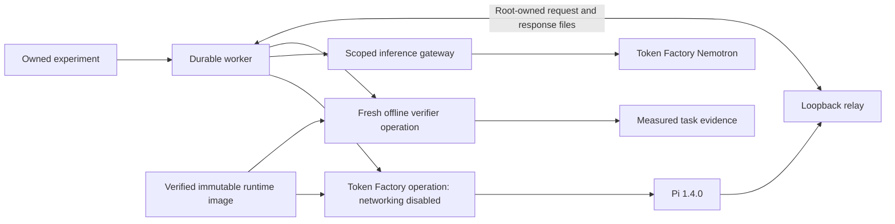
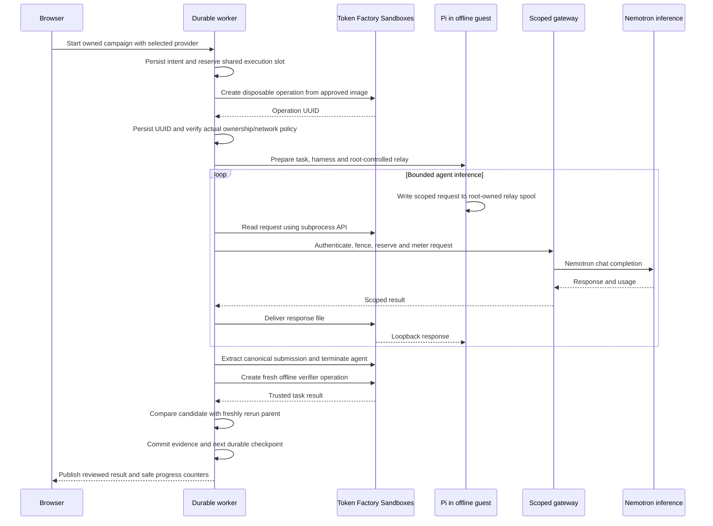

# Token Factory Sandboxes execution

29 October 2026. Access was verified with authenticated read-only `whoami` and image discovery. The account permits spawn, disposable spawn, import, list and cancel, with 50 concurrent operations and a 3600-second maximum. LoopBench keeps its own lower concurrency and timeout controls.

## Provider boundary

Token Factory is a second execution provider, fixed for the lifetime of a campaign. An E2B comparison cannot become a Token Factory comparison midway through a lineage. Both providers use the same Pi harness schema, canonical submission extractor, trusted benchmark and fresh-parent comparison policy.

Token Factory operations start from immutable filesystem images. A bounded primary process keeps an operation alive while the REST subprocess API controls Pi and reads durable logs. This is an operation-backed controller, not a claim that process memory survives checkpoints.

The public networking contract provides an on/off switch, without a documented destination allowlist. Agent and verifier operations therefore start with networking disabled. Pi uses a loopback-only relay. The trusted host transports requests through the subprocess/file API, applies the existing scoped inference gateway, and delivers the response to that relay. The Nebius account key stays outside the guest. Only the runtime preparation operation uses networking to install the pinned Pi package from the official npm registry.

## Persistence and recovery

Persist an owned intent before each operation request and save the accepted operation UUID immediately. Never replay an ambiguous creation or subprocess start. Cancellation is restricted to matching project, immutable image and platform ownership metadata. Confirm a terminal provider status before freeing the local slot. Lost requests remain uncertain and discoverable by their intent marker.

Prepare the runtime once from a pinned Node 24 image, install Pi 1.4.0, verify Node/Pi and required privilege tools, and retain the resulting image UUID. Task attempts branch independently from that same clean image. Agent operations are disposable so scoped tokens and conversation state do not become reusable images. Submission artifacts stay in LoopBench's private evidence store.

## Accounting

The user lifted the earlier project validation spending restriction. This does not change unrelated visitors' allowances or make unknown charges free. Inference continues through the existing exact-money gateway. Token Factory operation IDs, durations and raw resource observations are retained separately from E2B charges. The documented operation `cost` has unconfirmed monetary units, so it must not be converted into dollars or charged at the E2B rate. The UI labels sandbox monetary cost as unavailable until a tariff or billing record establishes it.

Primary contracts: [access](https://docs.tokenfactory.nebius.com/sandboxes/start/set-up-access), [operation lifecycle](https://docs.tokenfactory.nebius.com/sandboxes/concepts/execution-lifecycle), [subprocess control](https://docs.tokenfactory.nebius.com/sandboxes/guides/run-subprocesses-and-send-input), [networking](https://docs.tokenfactory.nebius.com/sandboxes/guides/configure-networking-and-secrets), [usage units](https://docs.tokenfactory.nebius.com/sandboxes/operate/limits-retention-and-usage).
