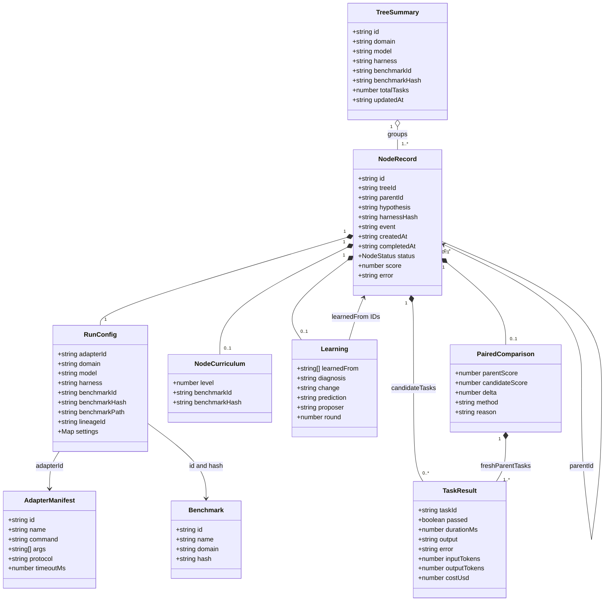
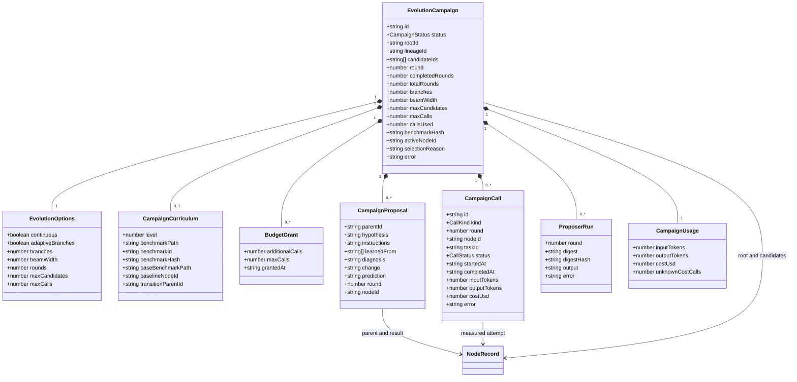
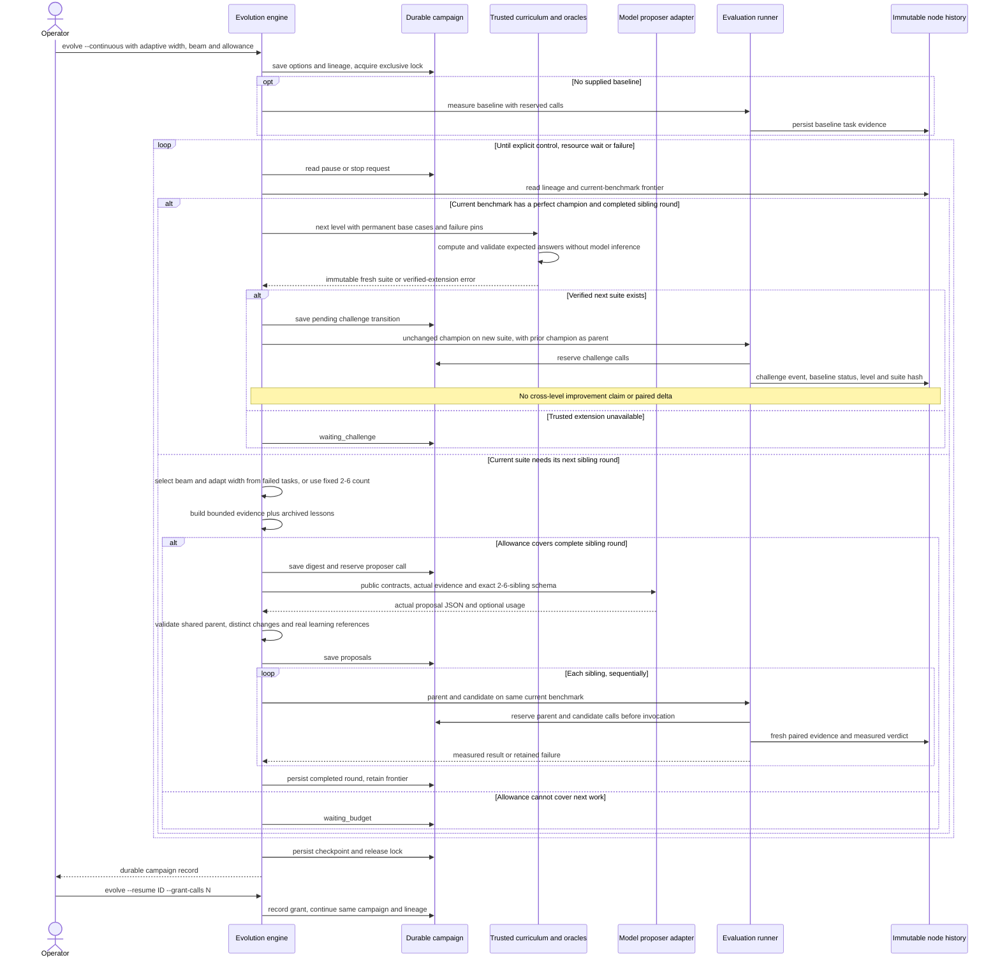
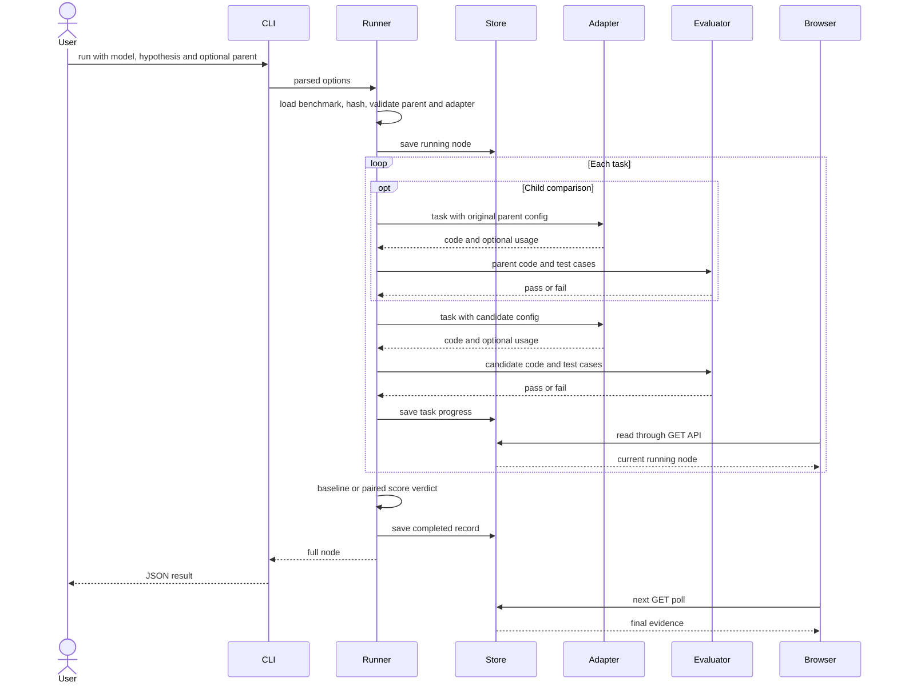
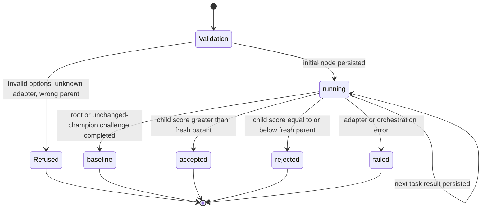
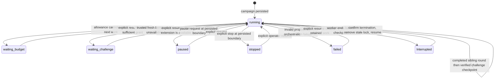
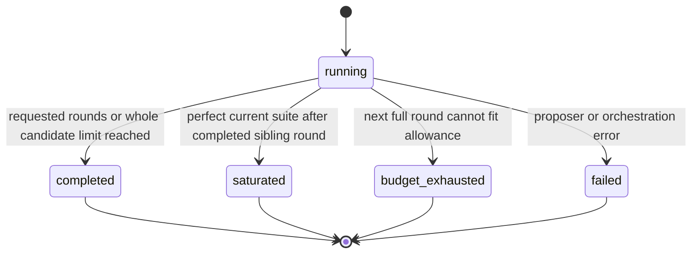
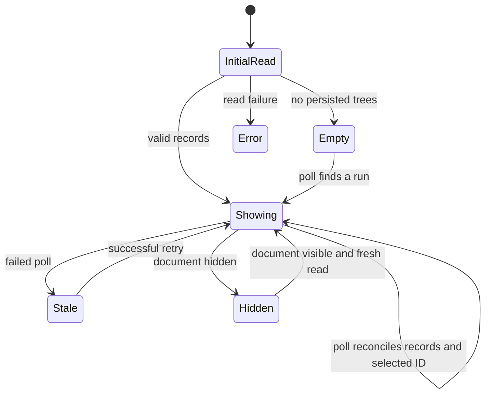

# UML and execution models

Proposed hosted domain, lifecycle and deployment diagrams are in [HOSTED-UML.md](HOSTED-UML.md). The diagrams below describe the current local implementation.

These diagrams describe the local implementation. The records are TypeScript data structures; the module boxes name functions rather than classes that the code does not contain.

## Data relationships

`parentId`, `completedAt`, `score`, `error`, `comparison` and usage fields can be null where the shared schema permits it. `benchmarkPath`, `lineageId`, `learning`, `event` and `curriculum` are optional for historical compatibility. `event` is `evaluation` or `challenge`. A challenge checkpoint is a `baseline` with a structural parent, unchanged instructions and no paired comparison. Its benchmark hash differs from the prior level. Continuous lineage identity retains the same tree across those revisions; adopting an existing finite tree does not copy or rewrite its history. Association arrows describe identity references, not automatic database foreign keys. Tree grouping is derived from node files each time it is read. Benchmark hash covers definition, evaluator source and controller source digests.

## Campaign records

Campaign options preserve the configured adapter/model/harness, benchmark source, settings and limits. A proposal's `nodeId` is null until its evaluation starts. A call's `nodeId` is null for proposal inference. Calls use kinds `proposal | baseline | parent | candidate | challenge` and statuses `reserved | completed | failed`. Campaign usage is a subtotal of reported values with an explicit count of unknown-cost calls. It is not a provider invoice.

Continuous mode ignores the finite `rounds` and `maxCandidates` ceilings. `options.adaptiveBranches` enables a width of 2-6 based on measured failures. New continuous campaigns enable it when no explicit branch count is supplied; finite campaigns default to a fixed two siblings. An explicit `--branches N` fixes the count within that range. `campaign.branches` stores the current width; `beamWidth` bounds the eligible parent frontier. The adaptive count is `min(6, 2 + distinct failed task IDs)` from the current beam and latest completed round on the same benchmark, including paired-parent failures. Once proposals are saved, that round keeps its width across resumption. `budgetGrants` records each explicit addition to the invocation allowance. Campaign curriculum references the current suite and the unchanged-champion checkpoint required before branching on a new level.

## Continuous learning sequence

The proposer receives public prompts and bounded evidence rather than test cases or expected answers. Continuous requests retain eligible parents, nearby ancestry and recent experiments, plus compact summaries of archived failures and strategies, within 120,000 serialized characters. Full records stay on disk. `learnedFrom` includes the shared parent and only visible real evidence IDs; when measured mistakes are visible, each proposal cites at least one relevant mistake. It need not enumerate every historical record. Structural parentage and learning references are separate relations. This loop changes harness instructions, not model weights or arbitrary repository source.

The curriculum starts with 64 adversarial cases and introduces 48 fresh cases per level. It keeps all base cases, level-one anchors, the latest eight complete levels and every identified historical failing check. Generator/oracle source, base benchmark, seed, level and pins determine the immutable artifact identity. Per-case complexity bounds contain evaluation work; fresh deterministic inputs continue at later levels. Unsupported task contracts wait for a trusted extension.

## Run sequence

Adapter/process failure can interrupt the loop. The runner then stores `failed` with an error and any candidate tasks already completed. It does not skip the error and silently compare incomplete batches. A returned VM execution error is a task failure; evaluator startup, outer timeout, abnormal exit or invalid protocol is an evaluation failure. Campaign call controls record reservations and usage around the adapter independently of the evaluator result.

## Node state machine

Validation and Refused are orchestration states, not `NodeRecord.status` values. A refused request may create no node. The persisted enum is exactly `running | baseline | accepted | rejected | failed`. A process crash may leave `running` on disk; there is no recovery daemon that invents a terminal state.

## Continuous campaign state machine

Continuous evolution has no terminal generation or lifetime candidate count. A budget wait, unavailable challenge, pause or stop preserves its lineage and ledger; none asserts that the harness has finished evolving. Explicit resume of a failed campaign checks retained state, but does not retry an invalid/interrupted proposer or silently replace failed evidence. Some failures therefore require a new campaign from a completed node.

Interrupted is an operational condition; the file remains `running`. Every existing lock is refused. After explicit stale-lock cleanup, resume marks interrupted reserved calls failed and spent, marks an incomplete active node failed, and continues only unattempted work. The ledger invariant is `callsUsed = calls.length ≤ maxCalls`. Grants increase `maxCalls` and remain recorded. Calls include proposal, baseline, challenge and both paired comparison sides. Opaque adapters may make internal provider requests or tool calls, so this is not a billing guarantee.

## Legacy finite campaign states

These finite states apply when `--continuous` is absent. They support bounded checks. A still-running finite campaign can recover after explicit stale-lock cleanup; terminal finite campaigns stay terminal on resume.

## Viewer state machine

The viewer's selection and active tabs are local presentation state. Only runner writes can change a node's recorded status. Copying a command or selecting a graph node has no execution side effect.
