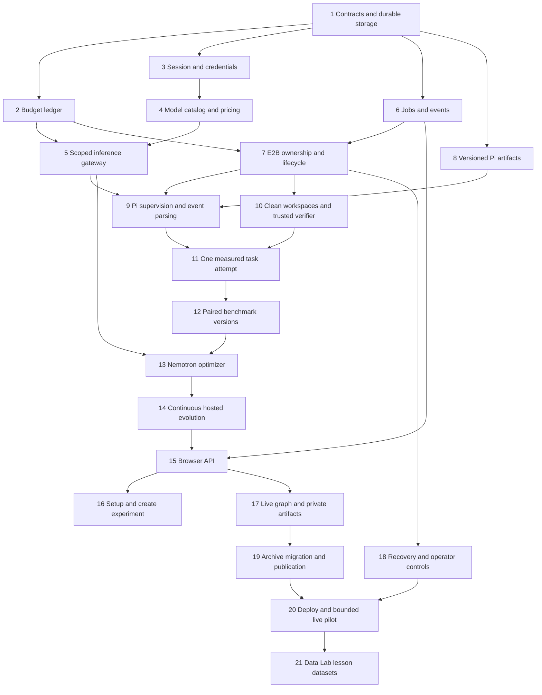

# Hosted Pi and E2B Implementation Plan

> **For agentic workers:** REQUIRED SUB-SKILL: Use superpowers:subagent-driven-development (recommended) or superpowers:executing-plans to implement this plan task-by-task. Steps use checkbox (`- [ ]`) syntax for tracking.

**Goal:** Let a user connect Nebius credentials, run a versioned Pi harness powered by the cheapest compatible NVIDIA Nemotron in E2B, and inspect actual continuous branching improvements within separate inference and compute allowances.

**Architecture:** Next.js handles authenticated session boundaries and read projections. A persistent Node worker schedules finite durable steps through SQLite, E2B isolates task and verifier execution, and a scoped gateway accounts for every Token Factory request. The existing local CLI, archived records and independent grading semantics remain intact.

**Tech Stack:** Next.js 16.4.3, React 19.2.4, TypeScript, Zod and SVG; `node:sqlite` on the local Node 25 host with Node 24 LTS as the permanent-deployment target, official E2B JavaScript SDK, verified Pi 1.4.0 / Node v24.15.0 cloud template, Node crypto and persistent disk. Permanent TLS reverse-proxy assets are supplied but not deployed. No ORM, Redis or orchestration cluster for the single-host pilot.

**Spec:** [E2B/Pi design](../specs/2026-10-27-e2b-pi-design.md), [architecture](../../ARCHITECTURE-HOSTED.md), [contracts](../../HOSTED-CONTRACTS.md), [operations](../../HOSTED-OPERATIONS.md), [UX](../../HOSTED-UX.md), [UML](../../HOSTED-UML.md).

**Status:** Implementation in progress as of 28 October 2026. Hosted storage, budgets, credentials, jobs/events, model discovery, gateway, Pi/E2B execution, continuous scheduling, browser workflow, operations and verified lesson export now have code and focused checks. The original checkboxes below remain the review checklist, not a claim that all live milestones are complete. See `docs/HOSTED-RUNBOOK.md` and `docs/VALIDATION.md` for readiness and actual live evidence.

## Implementation status — 28 October 2026

This matrix records current code, checks and observed limits. The original task checklists below are retained as the historical implementation plan; their unchecked boxes are not the authoritative record of which modules now exist. The final suite passed 120/120 tests with zero skips or failures, typecheck and production build. Final public HTTPS ownership/origin/gateway smoke checks passed without paid operations. Full evidence is in [Validation evidence](../../VALIDATION.md).

| Task                      | Current implementation and checks                                                                                 | Live evidence or remaining limit                                                                                                                              |
| ------------------------- | ----------------------------------------------------------------------------------------------------------------- | ------------------------------------------------------------------------------------------------------------------------------------------------------------- |
| 1 — Contracts/storage     | SQLite schema/migration, WAL transactions, ownership and exact-money tests.                                       | Persistent local hosted database used by the actual pilot; permanent Linux deployment pending.                                                                |
| 2 — Budget reservations   | Atomic linked compute holds, separate inference ledger, uncertainty, allowance and two-process contention checks. | Actual provider obligations retained; aggregate demo inference approval USD 0.50. Invoice/balance certainty is not claimed.                                   |
| 3 — Sessions/credentials  | Signed opaque sessions, AES-GCM vault, revocation, same-origin and cross-owner checks.                            | Actual owned Nebius key connection; no full account login/recovery.                                                                                           |
| 4 — Model selection       | Live verbose catalog/pricing and same-workload cheapest-compatible selection.                                     | Actual selected Nemotron Lightning; streaming tool and strict JSON probes passed.                                                                             |
| 5 — Inference gateway     | Scoped grants, request bounds, durable usage, streaming and failure regressions.                                  | Real executor/proposer inference metered; unknown outcomes remain held.                                                                                       |
| 6 — Jobs/events           | Durable jobs, targeted claims, fencing, checkpoints and replay cursor checks.                                     | Independent worker and browser polling used live; broader crash-recovery scenarios remain deterministic checks.                                               |
| 7 — E2B ownership         | Durable intents, ownership metadata, slots and confirmed-termination accounting.                                  | Real agent/verifier environments and cleanup; transport uncertainty is preserved.                                                                             |
| 8 — Harness artifacts     | Strict reusable artifacts, hashes and approved runtime manifest.                                                  | Actual Pi 1.4.0 / Node v24.15.0 template `x9swjt4humgif3wctzqj`, 2 vCPU / 2048 MiB.                                                                           |
| 9 — Pi supervision        | Root-owned supervisor, bounded durable RPC logs and settled/process completion checks.                            | Actual tool use and scoped call-limit termination observed; provider failures remain distinct from benchmark outcomes.                                        |
| 10 — Trusted verifier     | Clean task workspaces, canonical extraction and fresh immutable grading.                                          | Real independent verification on the six function contracts; broader repository tasks remain outside this pilot.                                              |
| 11 — Measured task        | Full agent/grant/artifact/verifier/cleanup path with typed outcomes.                                              | Real scored tasks; later agent-cleanup failure before verifier admission remained unscored.                                                                   |
| 12 — Paired versions      | Complete-suite checks, fresh parent reruns and strict positive-delta acceptance.                                  | Baseline 1/6; two completed ties (1/6 vs 1/6, 0/6 vs 0/6), both rejected.                                                                                     |
| 13 — Nemotron optimizer   | Validated distinct same-parent proposals with evidence references.                                                | Six genuine proposals recorded; two siblings fully evaluated.                                                                                                 |
| 14 — Continuous evolution | Durable round/proposal/task checkpoints and curriculum scheduling.                                                | Same pilot resumed with four siblings running or pending and historical failures preserved; no accepted improvement or completed deep hosted lineage claimed. |
| 15 — Browser APIs         | Owned mutation/read, allowance, event and artifact routes with origin/idempotency tests.                          | Live private HTTP/session checks; permanent public deployment remains pending.                                                                                |
| 16 — Setup/create UX      | Credential setup, model/allowance review and experiment creation components.                                      | Actual credential/catalog connection; full form viewport/accessibility coverage remains pending.                                                              |
| 17 — Graph/evidence views | Owned graph projections, selection, event polling and attempt/artifact views.                                     | Production-build public HTTPS graph, node selection and Tree/Stats controls verified in the in-app browser.                                                   |
| 18 — Recovery/operations  | Reaper, fenced cleanup, status, readiness and operator allowance tools.                                           | Actual cleanup and budget reconciliation recorded; broader host-failure/restore rehearsal remains pending.                                                    |
| 19 — Publication/archive  | Explicit sanitized immutable snapshots and authorized artifact retrieval, with publication checks.                | Historical local records preserved; current private pilot evidence is not automatically published.                                                            |
| 20 — Deployment/pilot     | Runtime build/probe, approved manifest, deployment assets and bounded live pilot.                                 | Actual baseline and two paired siblings plus passing build/browser checks; permanent Linux deployment and public submission video pending.                    |
| 21 — Lessons/Data Lab     | Verified paired-evidence JSONL export, provenance and deterministic export checks.                                | Private export succeeded with two actual paired-evidence rows; no Data Lab upload, controlled lesson ablation or model-weight training performed.             |

Permanent Linux deployment, restore rehearsal, a public submission video and actual Data Lab cloud import/lesson ablation remain unverified. The completed pilot comparisons establish no measured gain; implemented modules do not make every planned milestone complete.

## Global constraints

- Preserve the dark Petri-style horizontal tree and real parent/child topology. No mock production trees.
- Pi is the hosted harness. Do not reinstall or modify the user's global Pi installation. Verify the actual cloud Pi version independently.
- Nemotron powers both executor and optimizer through Token Factory. Use the same selected model for both roles in the first release.
- Choose the cheapest currently available **compatible NVIDIA Nemotron** using live model/pricing metadata and a versioned input/output workload estimate. Do not equate the cheapest input-token rate with the cheapest complete request. Prefer Lightning in a verified price tie; never silently fall back to Super or Ultra.
- `nvidia/Nemotron-3_5-Lightning` is a documented candidate, not an assumed available alias. Confirm the exact ID, tool behavior and proposal JSON support in the account before enabling it.
- The user plans to add USD 5 to Nebius. This is account-balance context, not authorization to spend USD 5 on each campaign and not E2B credit. Do not automatically top up, infer balance from a model-list success, or spend the whole balance.
- E2B total demo compute ceiling is USD 100 across all users and campaigns, cumulative without automatic reset. Ordinary admission USD 90 plus USD 10 held for uncertainty.
- Proposed defaults: USD 5 campaign compute; USD 0.20 campaign inference; USD 0.50 operator inference maximum; 2 active sandboxes globally; 600-second sandbox TTL; 60-second job lease; 15-second heartbeat and reaper; 2-second visible browser polling.
- Every round contains 2-6 distinct same-parent sibling proposals. Complete saved siblings before advancing a mastered challenge. Continuous evolution has no fixed generation ceiling; pause on resource/access limits rather than declaring completion.
- Hidden acceptance cases, expected answers, platform keys and user Nebius keys stay outside agent workspaces.
- A harness version is not a sandbox, provider call or task attempt. Treat ancestry and evidence relationships separately.
- New hosted private records require owner-scoped queries. Legacy global GET routes cannot expose private hosted or unreviewed archive data.
- Read the installed Next.js documentation before route/page implementation. Current route parameters are asynchronous; do not implement from remembered older conventions.
- Preserve benchmark/evaluator source bytes until an explicit benchmark revision is introduced. Do not rewrite historical records to fit a new schema.
- Production code changes start only after this documentation phase. Later test fixtures stay in temporary stores and never populate a real catalog.

## Review focus

1. An E2B create succeeds remotely but its response is lost: recover the accepted environment without a duplicate or released spend envelope. Owned by Tasks 7 and 18.
2. Two workers admit the last affordable job concurrently: exactly one transaction can consume that budget/slot, including after restart. Owned by Tasks 2 and 6.
3. A user guesses another user's campaign, artifact, credential or event cursor: return the same 404 shape without exposing ownership. Owned by Tasks 3, 14 and 17.
4. Pi finishes an assistant message, loses its stream or starts automatic compaction: count all upstream work and wait for the true settled boundary. Owned by Tasks 5, 9 and 11.
5. An agent edits a test, package script, symlink or harness resource: trusted verification still evaluates the original acceptance contract and rejects invalid artifacts. Owned by Tasks 8, 10 and 12.

## Plan map and dependencies

Milestone M1 is one isolated, independently graded Pi task through the real gateway, after Task 11. M2 is an actual same-suite paired version, after Task 12. M3 is autonomous 2-6-sibling evolution, after Task 14. M4 is the browser-driven owned workflow, after Tasks 16-18. M5 is the deployment/pilot, after Task 20. M6 adds the deeper Data Lab workflow, after Task 21. A milestone is not complete merely because a configuration file or fixture exists.

Parallelize only after shared contracts are landed: money/storage, identity/catalog and sandbox/event work can proceed in separate owned files. Task 14 depends on verified execution, not just UI stubs. Keep one integrator responsible for contract consistency. Review each task's focused changes and commit only its explicit paths after checks; never stage the entire existing dirty workspace.

## File structure and interface conventions

Use the file map in [architecture](../../ARCHITECTURE-HOSTED.md#module-ownership). Hosted DTOs live in `hosted/schema.ts`; canonical fields/states are defined in [contracts](../../HOSTED-CONTRACTS.md). Do not duplicate alternate lifecycle enums in UI code. UI labels such as “Waiting for compute” map to `Campaign.state = waiting` plus its typed `waitReason`.

`HostedContext` supplies `db`, `config`, a clock, credential cipher and provider transports. Pass it explicitly to side-effecting service functions. `OwnerScope` comes from the trusted session or fenced internal lease, never a client body. `UsdMicros` is a parsed decimal integer string at API boundaries and `bigint` internally. `Lease` contains job ID, worker ID, fence generation and expiry. No database transaction spans an `await` or remote request.

Pure reducers accept records and return decisions. Durable service functions validate/commit intent, perform the external operation outside the transaction, then reconcile with the expected fence. API handlers are adapters over those services, not a second implementation of budget or evolution rules.

### Task 1: Establish hosted contracts and SQLite persistence

**Files:** Create `hosted/schema.ts`, `hosted/config.ts`, `hosted/database.ts`, `hosted/store.ts`, `hosted/migrations/001-initial.sql`; test `tests/hosted-storage.test.ts` and `tests/hosted-config.test.ts`.

**Interfaces:** Produce `HostedContext`, `OwnerScope`, `UsdMicros`, the record/DTO schemas, `openHostedDatabase({path})`, `migrateHostedDatabase(db)` and synchronous `withHostedTransaction(db, callback)`. Store queries take owner scope or a distinct internal lease context. Tables, unique constraints and indexes follow HOSTED-CONTRACTS.

- [ ] Write failing tests named `migration_reopens_without_data_loss`, `foreign_owner_lookup_is_absent`, `micro_usd_round_trip_is_exact`, and `missing_hosted_secrets_fail_closed`. Assert a second migration leaves the schema version unchanged, foreign IDs return no row, `100000000` remains USD 100 exactly, and hosted mode cannot start with missing required configuration.
- [ ] Run `node --import tsx --test tests/hosted-storage.test.ts tests/hosted-config.test.ts`; verify the missing-contract failure before implementation.
- [ ] Implement schema/config and transactional repositories. Configure foreign keys, WAL, busy timeout and restrictive directory/file permissions. Use Node's SQLite API only after its chosen deployment runtime is verified; no ORM.
- [ ] Reopen a real temporary file-backed DB and exercise independent connections. Verify composite ownership constraints and optimistic record revisions, not only in-memory mocks.
- [ ] Run focused tests plus `npm run typecheck`; review the migration and commit only this task's files.

### Task 2: Implement atomic compute and inference reservations

**Files:** Create `hosted/budget.ts`, `hosted/pricing.ts`; test `tests/hosted-budget.test.ts`.

**Interfaces:** Consume Task 1 transactions. Produce `reserveBudget(input, context) -> BudgetReservation`, `settleReservation(input, context)`, `markReservationUncertain(input, context)` and `releaseReservation(input, context)`. Inputs identify obligation, accounts, amount, idempotency key and expiry. Amounts and state transitions follow the contracts document.

Also produce `approveInferenceAllowance({ownerScope, campaignId, newLimitUsdMicros, acceptedPricingSnapshotId, expectedRevision}, context)` and internal-only `grantCampaignComputeAllowance({campaignId, newLimitUsdMicros, operatorReason, expectedRevision, operationId}, context)`. Explicit approval creates an immutable audit record and does not resume the campaign. Neither operation can enlarge the platform's USD 100 ceiling or lower an allowance below spent plus held obligations. Same-limit inference approval can accept a refreshed pricing snapshot without granting more money. Internal `setPlatformAdmissionLimit` and `reconcileBudgetReservation` implement the audited operator-only contracts; they never enlarge the USD 100 ceiling or send a provider charge.

- [ ] Write failing tests `last_affordable_reservation_has_one_winner`, `uncertain_create_keeps_money_and_slot`, `child_reservation_does_not_double_count_round_envelope`, `campaign_inference_does_not_spend_compute_credit`, and `restart_does_not_reset_global_cap`.
- [ ] Assert platform USD 100, ordinary admission USD 90, explicit USD 10 reserve and separate USD 5 campaign compute. Exercise two actual DB connections/processes racing at the boundary. A second settlement must be idempotent; an incompatible replay must fail.
- [ ] Run `node --import tsx --test tests/hosted-budget.test.ts` and observe failure.
- [ ] Implement exact decimal price parsing and upward reservation rounding. Reserve a round envelope once; transfer its remaining obligations into operation holds atomically without counting parent/child envelopes twice. Keep uncertain amounts held. Define full-round inference preflight as an estimate; per-request bounds still control unexpected extra Pi turns and may checkpoint a round.
- [ ] Verify overflow, missing/stale prices, zero/negative grant, explicit allowance approval, same-limit new-price consent, partial create, late usage and a larger-than-estimated actual charge. The last condition closes admission and records a variance; never silently clamp a charge to make an allowance appear respected. An ordinary browser cannot grant platform-funded compute or exceed the operator inference ceiling.
- [ ] Run focused checks/typecheck, review monetary invariants and commit scoped paths.

### Task 3: Add owned sessions and encrypted BYOK credentials

**Files:** Create `hosted/auth.ts`, `hosted/credentials.ts`; test `tests/hosted-auth.test.ts`, `tests/hosted-credentials.test.ts`.

**Interfaces:** Produce `resolveSession(request, context) -> SessionContext`, `requireBrowserMutation(request, context)`, `connectCredential({ownerScope, apiKey}, context) -> CredentialSummary`, `revokeCredential({ownerScope, credentialId}, context)` and an internal decrypt operation unavailable to browser projections.

- [ ] Test `forged_session_and_foreign_credential_are_not_found`, `browser_origin_is_checked_against_configured_origin`, `secret_never_appears_in_api_projection`, and `revocation_disables_existing_gateway_scope`. Use a unique non-provider fixture secret and recursively inspect persisted public DTOs/logs.
- [ ] Verify absent credentials do not block public catalog reads. Production cookies are HttpOnly/Secure/SameSite; local development origins are explicitly configured rather than accepting untrusted forwarded hosts.
- [ ] Observe failing focused tests, then implement authenticated encryption with key ID, random nonce, owner-bound associated data and external keyring. Queue jobs carry only credential IDs.
- [ ] Define rotation, deletion and session-expiry behavior. Restore must not resurrect a deleted key. Reconnecting a key never rewrites historic evidence or treats a successful model list as successful inference.
- [ ] Run focused tests/typecheck and commit scoped changes. Do not add raw keys to `.env.example`, test snapshots or commands.

### Task 4: Discover and select the cheapest compatible Nemotron

**Files:** Create `hosted/models.ts`, extend `hosted/pricing.ts`; test `tests/hosted-models.test.ts`.

**Interfaces:** Produce `listEligibleModels({ownerScope, credentialId, refresh}, context) -> ModelCatalog` and `selectCheapestModel({catalog, workloadProfile}, context) -> ModelSelection`. `ModelSelection` records exact ID, capability-profile version, price snapshot and selection rationale.

- [ ] Test `per_token_price_is_not_misread_as_per_million`, `lowest_input_rate_can_lose_on_output_cost`, `unknown_capability_is_not_enabled`, `cheapest_tie_prefers_verified_lightning`, and `missing_model_never_falls_back_to_costlier_model`.
- [ ] Use exact fixture metadata from the documented verbose catalog shape. `owned_by=system` is not proof a model is or is not NVIDIA; use provider namespace, verified model family and capability profiles. Exclude image, embedding and incompatible chat models.
- [ ] Observe failing tests, then implement authenticated server-side `GET /v1/models?verbose=true`. Cache at most 15 minutes per credential/account context; invalidate on authentication failures and revalidate selection/pricing at start or after a stale checkpoint.
- [ ] Rank uncached input plus output cost against the same versioned workload profile for all candidates. Cache discounts are upside, not admission assumptions. Pin the exact model throughout a lineage; a price refresh does not silently migrate models.
- [ ] Verify a missing/disabled cheapest model produces a visible choice or waiting state. Tool and JSON compatibility require a bounded live smoke before first release, not a model-name guess.
- [ ] Run focused checks/typecheck and commit scoped files.

### Task 5: Build the scoped Token Factory inference gateway

**Files:** Create `hosted/gateway.ts`, `hosted/gateway-tokens.ts`, `app/api/inference/v1/chat/completions/route.ts`; test `tests/hosted-gateway.test.ts`.

**Interfaces:** Produce `issueGatewayToken(scope, context) -> GatewayGrant`, `revokeGatewayGrant(id, context)` and `handleChatCompletion(request, context) -> Promise<Response>`. Internal scope includes owner, campaign, attempt/optimizer role, exact model, lease fence, expiry and token/call limits.

- [ ] Test `expired_or_stale_fence_cannot_send_upstream`, `model_override_and_arbitrary_url_are_rejected`, `reservation_precedes_upstream_send`, `tool_only_chunks_and_usage_only_chunks_are_valid`, and `disconnect_keeps_unknown_usage_reserved`.
- [ ] Observe failure using an injected HTTP transport with real streamed SSE frames, not a mock that invents the gateway's final result.
- [ ] Implement the fixed-host HTTPS Token Factory route, redirects refused, bounded text/tool payloads and output tokens. First release permits only verified chat completions. Browser cookie authentication is not gateway-token authentication; E2B requests need not carry a browser Origin.
- [ ] Preserve tool calls, reasoning fields required by the verified model, SSE chunk ordering and terminal usage. Content may be null on a legitimate tool response. Store provider call ID, requested/returned model IDs, tokens/cache fields, timing and outcome. Missing usage is unknown, not zero.
- [ ] Account for Pi retries and compaction as separate upstream calls. Do not add hidden gateway retries or a fallback platform inference key. Redact upstream error bodies while preserving safe failure categories.
- [ ] Run focused checks/typecheck, inspect secret exclusions and commit scoped paths.

### Task 6: Add durable jobs, fencing and event cursors

**Files:** Create `hosted/jobs.ts`, `hosted/events.ts`; test `tests/hosted-jobs.test.ts`, `tests/hosted-events.test.ts`.

**Interfaces:** Produce `enqueueJob(input, context) -> Job`, `claimJob({workerId}, context) -> Lease | null`, `heartbeatJob(lease, context)`, `appendCampaignEvent(event, context) -> CampaignEvent` and `readCampaignEvents({ownerScope, campaignId, after, limit}, context) -> EventPage`.

- [ ] Test `duplicate_start_returns_same_job`, `expired_lease_is_reclaimed_with_new_fence`, `old_worker_cannot_commit_or_renew`, `event_cursor_reconnect_has_no_gaps`, and `foreign_cursor_does_not_reveal_private_events`.
- [ ] Observe failure, then implement atomic campaign+job creation and fenced job progression. Keep remote work outside DB transactions and preserve the same logical job ID on lease recovery.
- [ ] Append state changes and events in the same transaction. Page events in ascending durable sequence. A retention gap returns a current snapshot/reset instruction rather than a silent empty stream.
- [ ] Verify the canonical Campaign/Job/TaskAttempt states from HOSTED-CONTRACTS. Do not invent UI-specific storage enums or mark a continuous campaign completed at 100%.
- [ ] Run focused checks/typecheck and commit scoped changes.

### Task 7: Own E2B creation, admission and termination

**Files:** Create `hosted/e2b.ts`, `hosted/sandboxes.ts`; test `tests/hosted-sandboxes.test.ts`.

**Interfaces:** Produce a narrow `E2BTransport` with create/list/connect/inspect/terminate operations; `createAttemptSandbox(input, context) -> SandboxHandle`, `reconcileSandboxIntent(intentId, context)` and `terminateOwnedSandbox(input, context)`. Persist a creation intent before transport invocation.

- [ ] Test `accepted_create_with_lost_response_is_discovered_once`, `two_workers_cannot_create_same_intent`, `failed_kill_retains_full_reservation`, `unowned_sandbox_is_never_killed`, and `verifier_counts_toward_global_two_slots`.
- [ ] Observe failure with a stateful provider simulator that models accept-then-disconnect and discoverable metadata. This proves control logic, not real provider compatibility.
- [ ] Add the official E2B SDK only in this task; resolve a version supporting required APIs and pin it in the lockfile. Inspect automatic create retries. If safe creation cannot be expressed, use a bounded no-retry creation transport and the SDK for subsequent controller operations.
- [ ] Create from a pinned template/snapshot with intent metadata, 600-second maximum initial TTL and explicit network policy. Default to kill on expiry and disable automatic resume. Do not supply the actual Nebius credential or E2B controller credentials to Pi.
- [ ] Reconcile ambiguous outcomes by metadata before replacement; block when ownership is unknown. Start siblings individually; batch fork optimization is outside the initial implementation.
- [ ] Run focused checks/typecheck, review SDK version assumptions and commit scoped paths.

### Task 8: Package immutable, permitted Pi harness versions

**Files:** Create `hosted/harnesses.ts`, `sandbox/pi/models.example.json`, `sandbox/pi/runner-manifest.example.json`; test `tests/hosted-harnesses.test.ts`.

**Interfaces:** Produce `validateHarnessArtifact(raw) -> HarnessArtifact`, `hashHarnessArtifact(artifact) -> HarnessHash` and `materializeHarnessArtifact(input, context) -> ArtifactRef`. Never load the user's global Pi configuration into hosted work.

- [ ] Test `same_content_has_same_hash`, `credential_or_executable_escape_is_rejected`, `unknown_policy_field_is_rejected`, and `mutated_runtime_artifact_invalidates_attempt`.
- [ ] Observe failure, then define the initial permitted mutation surface: reusable prompt additions, skills, approved tool-policy choices, error-review/verification policy and bounded compaction settings. No arbitrary model-generated extension code in the first release.
- [ ] Pin Pi/Node/runtime/tool definitions in the artifact manifest. Provider configuration uses the scoped gateway and exact selected Nemotron model. Examples contain placeholders, not operational secrets.
- [ ] Ensure a task solution cannot be smuggled into a reusable harness artifact. Record hypotheses as unproven until fresh evaluation.
- [ ] Run focused checks/typecheck and commit scoped changes.

### Task 9: Supervise Pi and parse its real event lifecycle

**Files:** Create `hosted/pi.ts`, `hosted/pi-events.ts`, `sandbox/pi/supervisor.mjs`; test `tests/hosted-pi-events.test.ts`.

**Interfaces:** Produce pure `reducePiEvent(state, event) -> PiRunState`, `startPi(input, context) -> PiExecutionHandle`, `collectPiExecution(handle, context) -> PiExecutionResult` and `stopPi(handle, context)`.

- [ ] Test `prompt_acceptance_is_not_completion`, `agent_end_can_be_followed_by_recovery`, `settled_plus_process_end_is_terminal`, `length_or_error_stop_is_not_success`, and `reconnect_replays_logs_without_double_counting_usage`.
- [ ] Use captured **sanitized** version-matched Pi event fixtures from its documented protocol, plus malformed/truncated frames. Document any fixture origin; no provider run is implied by fixture replay.
- [ ] Observe failure, then implement the supervisor with structured stdin/RPC or JSON mode, separate diagnostics and durable bounded files. Never interpolate user prompts into a shell command. Use the actual cloud Pi event version and wait for `agent_settled` plus wrapper completion.
- [ ] Redirect logs for reconnection rather than depending on the original SDK stream. Enforce output bounds, cancellation and manifest integrity. Gateway usage is authoritative for admission; Pi totals are cross-checks, not additional charges.
- [ ] Run focused checks/typecheck and commit scoped files.

### Task 10: Create clean task workspaces and trusted verification

**Files:** Create `hosted/task-workspaces.ts`, `hosted/verifier.ts`, `sandbox/verifier/manifest.example.json`; test `tests/hosted-verifier.test.ts`.

**Interfaces:** Produce `buildTaskWorkspace({benchmarkHash, taskId}, context) -> WorkspaceManifest`, `extractSubmission(input, context) -> SubmissionArtifact`, and `verifySubmission(input, context) -> VerificationResult`.

- [ ] Test `agent_workspace_contains_no_hidden_cases`, `edited_public_tests_do_not_change_verdict`, `symlink_and_path_escape_are_rejected`, `grader_failure_is_infrastructure_failure`, and `grader_bytes_match_recorded_hash`.
- [ ] Observe failure, then expose each existing adversarial function prompt as a small repository with canonical `src/solution.cjs` and explicitly public smoke checks. Reuse existing contract and curriculum bytes; do not silently change the benchmark hash.
- [ ] Extract only the canonical output and allowlisted diff/metadata. Create a fresh verifier environment from its trusted pinned manifest, inject the original acceptance cases and submission, disable network and execute the immutable evaluator protocol.
- [ ] Store the grader result and safe named diagnostics. Host API/worker processes never evaluate untrusted submitted JavaScript directly. Node VM limits remain defense within the isolated environment, not the sole security boundary.
- [ ] Verify wrong output, thrown error and input mutation remain benchmark failures, while process launch/timeout/protocol failures invalidate evaluation. Existing evaluator source stays unchanged.
- [ ] Run focused tests plus existing `tests/evaluator.test.ts` and `tests/curriculum.test.ts`; review diffs and commit scoped files.

### Task 11: Deliver one owned, measured task attempt

**Files:** Create `hosted/attempts.ts`, extend `hosted/worker.ts`; test `tests/hosted-attempts.test.ts`.

**Interfaces:** Produce `runTaskAttempt({lease, attemptId}, context) -> TaskAttempt` using Tasks 2, 5 and 7-10. It records execution and verification phases separately and owns cleanup.

- [ ] Test a real isolated local process fixture through the production event parser and existing evaluator, with simulated E2B transport only. Assert it creates intent, records canonical output, independently grades, emits ordered events and finalizes cleanup without seeded catalog records.
- [ ] Test injected failure at each boundary: reservation/create, agent start, stream collection, extraction, verification, result commit and kill. Assert no stale fence can commit a score and no uncertain remote obligation is released.
- [ ] Observe failure, implement only one finite attempt, then verify recoverability after process restart. No autonomous evolution yet.
- [ ] Run focused checks/typecheck and commit scoped paths. M1 code capability is reached; actual E2B/Nemotron evidence remains a later pilot gate.

### Task 12: Measure full versions and paired comparisons

**Files:** Create `hosted/evaluation.ts`, `hosted/comparisons.ts`; test `tests/hosted-comparisons.test.ts`.

**Interfaces:** Produce `evaluateVersion(input, context) -> VersionEvaluation`, `buildComparisonContext(input) -> ComparisonContext`, and pure `decidePairedVerdict(parent, candidate, comparisonContext) -> VersionVerdict`.

- [ ] Test `historical_parent_score_cannot_substitute_for_fresh_parent`, `cross_model_or_template_comparison_is_refused`, `tie_is_rejected`, `incomplete_parent_invalidates_comparison`, and `all_six_tasks_are_required_for_full_suite_score`.
- [ ] Observe failure, then run fresh parent/candidate task batches from identical clean contexts. Record their actual task IDs, grader revisions, hardware policy and model/template versions. Mark a node baseline/accepted/rejected/failed only under the canonical evidence rules.
- [ ] Persist task and version progress transactionally. Parent reruns are comparison evidence, not invented new harness versions. Preserve every failed attempt without asserting improvement.
- [ ] Run focused checks plus current runner/evolution regression tests; commit scoped changes. M2 is reached in deterministic execution.

### Task 13: Generate Nemotron proposals through Token Factory

**Files:** Create `hosted/optimizer.ts`, extend `hosted/harnesses.ts`; test `tests/hosted-optimizer.test.ts`.

**Interfaces:** Produce `buildOptimizerDigest(input) -> OptimizerDigest`, `proposeSiblingArtifacts(input, context) -> SiblingProposal[]` and pure `validateSiblingProposals(input) -> ValidatedSiblingSet`.

- [ ] Test exact sibling count 2-6, one shared eligible parent, distinct artifact changes, known lesson references, required parent reference and no expected-answer leakage. Reject an invalid later sibling atomically; no partial proposal set commits.
- [ ] Observe failure, then send bounded real evidence through the same scoped gateway with role `optimizer`. Use schema-constrained output only for the selected model's verified profile and preserve application validation.
- [ ] Reuse the existing bounded-context/archived-lesson approach with a 120,000-character digest limit. Distinguish measured failures from the model's diagnostic hypothesis. Do not allow the optimizer to edit grading cases or embed task answer code in skills.
- [ ] Preserve failed/quota-limited proposer calls and their usage. A request to resume is explicit; no silent retry or costlier fallback.
- [ ] Run focused checks/typecheck and commit scoped paths.

### Task 14: Run continuous branching as durable finite steps

**Files:** Create `hosted/evolution.ts`, finish `hosted/worker.ts`; test `tests/hosted-evolution.test.ts`.

**Interfaces:** Produce pure `planNextEvolutionStep(campaign, evidence, resources) -> EvolutionDecision` and effectful `executeEvolutionStep({lease, decision}, context)`. Decisions include baseline, propose, evaluate saved sibling, advance challenge and typed checkpoint.

- [ ] Test at least 12 generations with 2-6 siblings per admitted round, preserved ancestry and true non-linear topology. Verify a perfect baseline still branches before its next challenge, paused rounds finish saved siblings, and changing suites never yields a paired improvement claim.
- [ ] Test partial compute/inference allowance, credential revocation, provider quota, missing validated curriculum and stale pricing. All retain evidence and wait for the right resource; none invents a completed result.
- [ ] Observe failure, then extract/reuse tested ranking, proposal and curriculum policy from the local implementation through pure interfaces. Hosted orchestration has durable jobs and fences instead of PID locks.
- [ ] Admit the planned round envelope before starting it, while acknowledging extra actual Pi turns may exhaust inference and checkpoint remaining siblings. Only global concurrency is two; round width remains 2-6. Early mastery does not skip pending siblings.
- [ ] Run focused tests and all existing local tests; review that local APIs/CLI semantics remain intact and commit scoped changes.

### Task 15: Expose bounded owned HTTP APIs

**Files:** Create `app/api/hosted/session/route.ts`, `credentials/route.ts`, `models/route.ts`, `catalog/route.ts`, `harnesses/route.ts`, `benchmarks/route.ts`, `campaigns/route.ts`, `campaigns/[id]/route.ts`, `campaigns/[id]/control/route.ts`, `campaigns/[id]/allowances/route.ts`, `campaigns/[id]/events/route.ts`, and `artifacts/[id]/route.ts` under `app/api/hosted/`; test `tests/hosted-api.test.ts`.

**Interfaces:** Implement exact methods, request DTOs, pagination and error codes from HOSTED-CONTRACTS. Session/owner identity is resolved server-side. API calls produce queued work and redacted projections, not long-running agent execution.

- [ ] Test a full request matrix: foreign IDs, expired cookies, guessed artifact IDs, invalid origin, duplicate idempotency keys, mismatched repeated bodies, unknown benchmark/harness, overlarge limits and event cursor reset.
- [ ] Observe failure, then add thin route handlers with Node runtime, explicit cache policy, bounded bodies and current Next route conventions. Keep gateway authorization separate from browser mutation checks.
- [ ] Make start/control requests idempotent. Return structured safe errors such as provider authentication, compute checkpoint or stale pricing without upstream secret-bearing bodies.
- [ ] Implement the separate owned allowance route for explicit inference approval or same-limit price refresh consent, with expected revision and idempotency. It does not grant compute, change model or resume the campaign. Resume remains a separate visible action. JSON event polling is required; an unsupported SSE negotiation returns the documented error until that extension is implemented.
- [ ] Disable unrestricted legacy global APIs in hosted mode; only explicitly published archive projections can be anonymous. Add a regression test that merely enabling hosted mode cannot expose `.loopbench` contents.
- [ ] Run focused checks, typecheck and production build; review routes and commit scoped files.

### Task 16: Build credential setup and experiment creation

**Files:** Create `app/setup/page.tsx`, `app/experiments/new/page.tsx`, `components/hosted/CredentialSetup.tsx`, `ExperimentForm.tsx`, `BudgetReview.tsx`; modify `app/layout.tsx`, `app/globals.css` and `components/TreeCatalog.tsx`; test `tests/hosted-form.test.ts` and browser acceptance flows.

**Interfaces:** Consume hosted session/catalog/credential DTOs. Send only credential handles after connection, exact model/harness/benchmark IDs, explicit allowances and an idempotency key. Never put secret values in persistent browser storage.

- [ ] Pin tests for key redaction, browsing without a key, cheapest-compatible selection, price timestamp display, missing-price disabled start, explicit allowance review and duplicate click protection.
- [ ] Observe failing form-state tests, then implement the HOSTED-UX route flow using existing colors, fonts and controls. The cheapest model is selected from server-ranked eligible Nemotron entries, not a hardcoded badge.
- [ ] Separate account balance context from per-campaign allowance. Explain USD 100 shared E2B compute, proposed USD 5 campaign compute and user-funded inference. Do not claim automatic provider balance lookup.
- [ ] Verify keyboard navigation, password reveal controls, narrow viewport, reconnect after expired credential and safe error copy in a real browser. No paid run is required for these UI checks.
- [ ] Run focused checks/typecheck/build, inspect the actual UI and commit scoped paths.

### Task 17: Connect the live horizontal graph and evidence views

**Files:** Create `app/experiments/[id]/page.tsx`, `components/hosted/ExperimentWorkspace.tsx`, `AttemptEvidence.tsx`, `HostedCampaignControls.tsx`; modify `components/LineageGraph.tsx`, `LearningRecord.tsx`, `CampaignProgress.tsx` and `live.ts` only through shared presentation interfaces; test `tests/hosted-projection.test.ts` plus existing graph tests.

**Interfaces:** Consume owned Campaign projection and EventPage. Produce the same real-node presentation shape for SVG without importing server stores into the client. Unknown/foreign pages show the same not-found experience.

- [ ] Test cursor reconnection, partial log frames, reset snapshot, node selection preservation and no overlapping polling. Test that proposals remain hypotheses and task/verifier sandboxes do not become graph nodes.
- [ ] Observe failure, then implement visible-page polling every two seconds with durable cursor; SSE is optional later. Browser closure does not cancel the worker. Preserve horizontal generation spacing, zoom, fit, root/head navigation and per-benchmark stats.
- [ ] Render typed waiting reasons, cleanup pending, estimated/unknown cost and inference/compute as separate values. Costlier model fallback and model switching within a lineage are unavailable.
- [ ] Verify an actual running application's graph with existing archived evidence and a fixture-backed private store explicitly isolated from production. Also verify empty state without fabricated nodes.
- [ ] Run focused tests, graph regressions, typecheck/build and browser acceptance; commit scoped changes.

### Task 18: Recover workers and stop owned resources

**Files:** Create `hosted/reaper.ts`, `scripts/hosted-worker.ts`, `scripts/hosted-reaper.ts`, `scripts/hosted-status.ts`, `scripts/hosted-grant-compute.ts`; test `tests/hosted-recovery.test.ts`.

**Interfaces:** Produce `reconcileHostedResources(context) -> RecoveryReport` and `runWorker(context, signal)`. Operator scripts call internal services, not private browser endpoints with fabricated owners.

- [ ] Test worker death before/after create, lost kill response, stale fence, expired token, orphan environment, full disk, DB contention and process shutdown. A reservation stays held if resource liveness is uncertain.
- [ ] Observe failure, then implement metadata-based reconciliation, environment expiry checks, token revocation and safe cleanup of only owned resources. Start the reaper before new admission after a restart.
- [ ] Add graceful SIGTERM drain and a global admission stop. Stop is immediate for gateway access; environment cleanup remains visible until confirmed. No automatic financial grant or replay of unknown inference.
- [ ] Expose the internal compute-allowance service through an operator-only local script requiring explicit amount, campaign revision and reason. Audit the action and recheck all platform obligations; do not create a browser route that spends the reserve or increases the total ceiling.
- [ ] Verify persistent log/artifact bounds and retention cleanup without deleting unsettled evidence. Restoring a backup starts credentials disabled and honors revocation tombstones.
- [ ] Run focused checks plus budget/job tests; commit scoped changes.

### Task 19: Preserve and publish historical evidence safely

**Files:** Create `hosted/artifacts.ts`, `hosted/publication.ts`, `scripts/hosted-import-archive.ts`; adapt public `app/page.tsx`, `app/tree/[id]/page.tsx` and read APIs; test `tests/hosted-publication.test.ts`.

**Interfaces:** Produce `publishCampaignSnapshot(input, context) -> PublishedSnapshot`, `importSelectedArchive(input, context) -> ImportReport` and authorized artifact retrieval by ID rather than raw paths.

- [ ] Test private records never appear anonymously, selected archive bytes remain unchanged, secrets/raw private logs are excluded, traversal/symlink artifact references fail, and publication snapshots cannot be overwritten in place.
- [ ] Observe failure, then import only operator-selected sanitized snapshots with provenance `legacy-local`. An archive reference never authorizes a hosted continuation under a changed runtime/context.
- [ ] Keep existing local CLI records and benchmark hash history. Do not present older Codex trees as Pi/Nemotron results or older timeout artifacts as verified gains.
- [ ] Run focused tests, old local store regressions and browser anonymous/private navigation; commit scoped paths.

### Task 20: Package deployment and perform a bounded real pilot

**Files:** Create deployment/reference assets under `deploy/`, `scripts/hosted-preflight.ts`, `scripts/hosted-pilot.ts`, `scripts/verify-hosted.ts`; update `.env.example`, `package.json` scripts and operator documentation only when implemented.

**Interfaces:** Preflight returns a typed readiness report without paid operations by default. `hosted-pilot` requires explicit limits and real configured provider access; it writes a provenance report and uses the same production ledger as browser jobs.

- [ ] Add tests for invalid/missing config, unreachable public gateway, unsupported template versions, absent provider spending-limit verification, unsafe legacy route exposure and pricing that cannot cover requested resources.
- [ ] Run `npm run typecheck`, `npm test`, `npm run build`, then start the actual production build. Existing tests must remain green; new tests cannot substitute for old regressions.
- [ ] Deploy on the selected persistent CPU host with TLS and externally stored secrets after the concrete deployment is authorized. Set/verify E2B account budget independently of the ledger; capture scope/reset/enforcement evidence without revealing credentials.
- [ ] Run the smallest explicitly bounded one-task smoke, label its subset and observe Pi tool use, Token Factory requests, trusted result and confirmed cleanup. Then run a full-suite baseline and at least two genuine siblings under an adequately admitted campaign. Never claim a one-task smoke proves all six contracts.
- [ ] Verify real browser setup, start, refresh/reconnect, pause/resume/stop, graph evidence and private/public access. Record actual model ID, template/Pi versions, request IDs, tokens, costs/unknowns and sandbox cleanup.
- [ ] Update `docs/VALIDATION.md` with actual outcomes and remaining limits. Prepare setup instructions, a public test build and a sub-three-minute demo showing a real generation. Preserve failures honestly. M5 is complete only with actual evidence, not SDK configuration.

### Task 21: Add the deeper Token Factory Data Lab lesson workflow

**Files:** Create `hosted/lessons.ts`, `integrations/nebius-data-lab.ts`, `scripts/export-lessons.ts`; extend owned evidence UI; test `tests/hosted-lessons.test.ts`.

**Interfaces:** Produce `buildLessonDataset(input, context) -> LessonDatasetArtifact`, `exportLessonDataset(input, context) -> DatasetExportReport`, and `planLessonAblation(input) -> ControlledExperiment`. This milestone follows a validated execution core and does not block the first smoke.

- [ ] Test that inference logs alone cannot assert a pass, external verdicts join only matching provider/task/harness/context IDs, held-out acceptance inputs/answers are excluded, and the same source set produces the same dataset hash.
- [ ] Observe failure, then assemble redacted JSONL with task family, trace references, verified failure category, hypothesis, harness digest and measured outcome. Respect the owner's data-export choice; never disable Zero Data Retention silently to obtain logs.
- [ ] Use the documented Data Lab dataset/import path and record the real dataset ID/version. If account capability or pricing is unknown, keep local export available and mark cloud integration unverified.
- [ ] Have Nemotron propose reusable lessons through the same budgeted gateway; test a lesson-enabled harness against the corresponding harness without the lesson and evaluate held-out cases. Keep model and task conditions fixed.
- [ ] Expose measured benefit or rejection with dataset/provenance links. Do not call this model-weight fine-tuning. Record actual Data Lab use before including it in the hackathon claim.
- [ ] Run focused and full checks, perform only an explicitly bounded real export/ablation, update evidence and commit scoped files.

## Scope and deferred work

### Requirement coverage

| Requirement                                  | Implementing tasks | Evidence required                                                                               |
| -------------------------------------------- | ------------------ | ----------------------------------------------------------------------------------------------- |
| User connects Nebius key before execution    | 3, 4, 15, 16       | Owned/redacted credential, verified catalog, safe browser setup                                 |
| Cheapest compatible NVIDIA Nemotron          | 4, 5, 13, 16       | Same-workload price comparison, capability smoke, pinned ID and no expensive fallback           |
| Real Pi agent in E2B                         | 7-11               | Actual filesystem/tool events, canonical submission and confirmed sandbox cleanup               |
| Independent trustworthy benchmark score      | 10-12              | Immutable grader, fresh verifier, original cases and complete same-context parent rerun         |
| Deep and wide continuous tree                | 12-14, 17          | Saved 2-6 siblings, multiple generations, true parent links and labeled challenges              |
| USD 100 total platform E2B cap               | 2, 7, 18, 20       | Concurrent ledger tests, uncertain-obligation retention and actual provider account controls    |
| Separate explicit Nebius allowance           | 2-5, 15-17         | Every upstream request reserved; account top-up never becomes an automatic grant                |
| Browser close/restart resilience             | 6, 9, 17, 18       | Durable IDs/events/logs, cursor recovery and no duplicate environment                           |
| Private user evidence and public demo        | 3, 15, 17, 19      | Direct API cross-owner denials and an explicit sanitized snapshot                               |
| Token Factory contribution beyond a selector | 5, 13, 21          | Real optimizer/executor calls, measured usage/cache behavior and actual lesson dataset workflow |
| Reproducible setup and reviewer access       | 18-20              | Version manifest, preflight, deployment/runbook, real pilot report and demo instructions        |

### Cost illustration and budget boundaries

Public Nemotron pricing researched on 27 October 2026 lists Lightning and Nano at USD 0.06 per million input tokens and USD 0.24 per million output tokens. At those rates, 100,000 input tokens plus 20,000 output tokens is USD 0.0108. This is arithmetic for a hypothetical token total, not an estimate of how many agent tasks or generations the user's planned USD 5 top-up buys. Pi tool loops, repeated parent runs, compaction and optimizer calls all consume tokens. Reconfirm actual rates and billable dimensions through the account before any request. [Published Nemotron rates](https://nebius.com/services/token-factory/models/nvidia-nemotron-models-inference).

For compute, an illustrative 2-vCPU/4-GiB sandbox at the published USD 0.000046 combined second rate costs USD 0.0276 for a full 600-second lifetime. A six-task baseline plus six siblings with fresh parent reruns is 78 task attempts; using separate agent and verifier environments can mean 156 lifetimes, or USD 4.3056 if every environment uses that full lifetime and configuration. This explains the proposed USD 5 compute default. It is not the actual `pi` template's confirmed profile, a promise a run fits, or an allowance to ignore setup/build/storage/network charges. Use actual resource metadata and conservative prices at admission. [E2B pricing](https://e2b.dev/pricing).

Compute allowance and user inference allowance fund different services. The platform's USD 100 ceiling also does not pay the CPU web host, domain or backup storage. Review those deployment costs separately; do not book them silently against either provider's credit.

The implementation phases above form one hosted pilot, not a promise to finish every production feature within five days. The five-day route in HOSTED-OPERATIONS prioritizes one verified vertical slice, then branching, browser control and release evidence. Data Lab is a separate follow-on milestone if the core is not yet reliable.

Defer PostgreSQL/multi-host workers, multi-region failover, full account recovery/login, arbitrary user shell adapters, model-generated executable extensions, broad repository-repair benchmarks, model-weight training, distributed attestations and automatic production promotion. Keep narrow interfaces for later additions without implementing speculative layers now.

## Information to configure before a live run

| Information                                                        | Why needed                                                     | Treatment                                                                |
| ------------------------------------------------------------------ | -------------------------------------------------------------- | ------------------------------------------------------------------------ |
| E2B platform project/key and verified remaining credit             | Creates paid environments under LoopBench ownership            | Secret configuration; never paste into chat                              |
| E2B dashboard USD 100 limit and its actual scope/reset/enforcement | Second spending control                                        | Operator verification before hosted admission                            |
| Actual Pi template/build ID, Node/Pi versions and resource profile | Reproducibility and compute estimation                         | Record verified metadata; do not rely on a moving `pi` alias             |
| Public HTTPS API/gateway origin and persistent host                | Cloud Pi must reach the gateway                                | Deployment configuration; hosting bill separate from E2B/Nebius          |
| Credential keyring and signing keys                                | Ownership and encrypted credentials                            | External secrets plus tested rotation/restore policy                     |
| Available cheapest Nemotron ID, capabilities and fresh rates       | Prevent unsupported model or unexpected expensive substitution | Authenticated discovery plus bounded compatibility smoke                 |
| User Nebius credential and explicit campaign allowance             | Inference billing belongs to the user                          | Encrypted owned credential; USD 5 account top-up is not a spending grant |
| Publication choice and real demo evidence                          | Judges need access without private keys/data                   | Explicit sanitized snapshot or controlled test build                     |

Unknown account details do not block writing deterministic application code after this plan is accepted. They do block a real provider call or a claim of live integration. No new purchase, automatic top-up, secret upload or deployment is implied by this plan.

## Completion checklist

- [ ] Every accepted requirement maps to a task and acceptance check.
- [ ] Runtime versions, effective provider limits and price units are verified.
- [ ] All existing and new deterministic tests pass; typecheck and production build pass.
- [ ] Private/session/gateway boundaries hold under direct API requests, not only UI controls.
- [ ] Unknown remote operations keep money and ownership reserved until reconciliation.
- [ ] A full-suite real Pi/Nemotron baseline and competing sibling set exist; no fixture rows are published.
- [ ] Continuous search can resume a checkpoint without resetting lineage, spend or saved proposals.
- [ ] Cleanup is confirmed and provider/ledger records are reconciled after the pilot.
- [ ] Deployment/restore/rollback instructions work, including credential revocation.
- [ ] Hackathon claims identify actual NVIDIA, Token Factory and E2B roles and their evidence limits.

## Review before execution

The user requested this planning phase before code. Review the architecture, proposed defaults and task boundaries first. The previously requested parallel-engineer method remains available: assign non-overlapping tasks after contracts stabilize, use a fresh task review, then integrate and verify the complete workflow. This plan does not itself start implementation or authorize paid provider operations.

## Documentation validation performed

On 27 October 2026, installed Prettier parsed/formatted the changed Markdown files. A local check scanned 21 Markdown documents for file links, heading anchors and balanced code fences, with no errors, and verified the 21-task ordering. The documentation set contains 25 Mermaid blocks including existing local diagrams; their blocks were checked, but a Mermaid rendering engine was not run. A before/after SHA-256 comparison of 50 runtime/configuration files found no changes. No application tests, dependency installations, provider requests, account-budget changes or deployments were performed for this documentation-only task.
