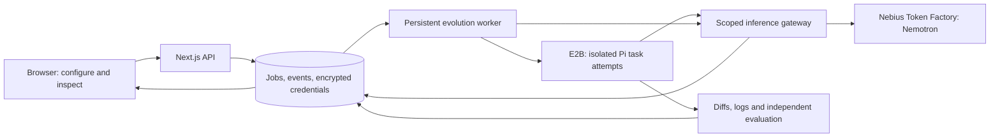

# Hosted Pi evolution with E2B and Nebius Token Factory

Status: proposed design for review. No implementation, deployment, template build or paid operation is authorized by this document alone.

## Agreed direction

- Pi is the evaluated coding-agent harness. Pi is already installed locally; do not reinstall or change the user's global installation.
- NVIDIA Nemotron, served through Nebius Token Factory, powers both task execution and harness improvement.
- E2B replaces the unavailable Nebius Sandboxes beta as the execution provider.
- LoopBench supplies E2B compute. The platform's total demo compute ceiling is USD 100 across all users and campaigns, not USD 100 per user or experiment.
- Users connect their own Nebius API key before starting experiments. Browsing published evidence does not require a key.
- The user plans a USD 5 Nebius inference account top-up and requests the cheapest compatible NVIDIA Nemotron. This is separate from E2B compute and does not grant a campaign the entire balance. Campaign inference remains an explicitly reviewed proposed USD 0.20 allowance with a proposed USD 0.50 operator ceiling.
- Preserve the Petri-style horizontal evolution graph and real evidence. Every admitted round proposes 2-6 distinct sibling harness changes. No seeded results or fabricated improvement.

## Verified provider capabilities

E2B publishes a pre-built `pi` template, supports headless Pi execution and permits deriving a custom template. The guide's sample model is Anthropic; LoopBench must explicitly configure a Nebius-compatible provider instead of copying that sample's authentication. Source: [official Pi guide](https://docs.e2b.dev/agents/pi).

Outbound internet is enabled by default. E2B supports deny-all rules with explicit allowed domains; domain filtering applies to HTTP(S). Source: [internet access](https://docs.e2b.dev/network/internet-access).

E2B supports snapshots and independent forks. A full snapshot can include process memory, so credentials and task-specific live agent state must not be captured in a reusable cross-user base. Source: [snapshots](https://docs.e2b.dev/sandbox/snapshots).

E2B documents per-second compute billing and dashboard spending limits. Its introductory USD 100 credit is a separate account entitlement that must be verified; the user's ceiling is a spending policy, not proof that credit remains available. Source: [billing and limits](https://docs.e2b.dev/billing).

## Approaches and selected architecture

| Approach                                   | Tradeoff                                                             | Decision                                                                    |
| ------------------------------------------ | -------------------------------------------------------------------- | --------------------------------------------------------------------------- |
| Local Pi execution                         | Uses the existing machine but requires each user to connect a worker | Keep local historical tooling; not the hosted demo's primary execution path |
| E2B execution with Token Factory inference | Managed task isolation; separate compute and inference accounting    | Selected                                                                    |
| Nebius Sandboxes execution                 | Potential future backend; beta access is currently unavailable       | Deferred                                                                    |

Proposed deployment default: one persistent CPU host runs the Next.js application and a separate Node worker process, with a durable database and artifact directory. E2B runs task environments. Token Factory runs the model. No local GPU or GPU rental is needed for this architecture. Hosting vendor and public HTTPS origin remain deployment configuration, not a change to the experiment semantics.

Use SQLite for the first single-host demo's durable job, credential, event and reservation records. Add a storage interface so a later multi-host deployment can use PostgreSQL. Existing local JSON evidence remains immutable and available as a separately identified archive; new private hosted records must not be exposed by the legacy global catalog API. The selected host needs persistent disk and backups. This is not a deployment for a filesystem-ephemeral web function.

## User workflow

1. Browse explicitly published real trees without providing credentials.
2. Connect a Nebius key over HTTPS. A server-side models request verifies authentication and returns eligible text-generation models; it does not guarantee sufficient credit or successful inference.
3. Select model, domain, Pi harness version and benchmark; set an inference allowance within operator limits.
4. Submit a job. The API returns its ID; the worker owns execution independently of the browser.
5. Inspect live parent/child ancestry, proposed changes, actual task progress, patches, test outcomes and cost estimates. Each tree node is a harness version with multiple task attempts, not an E2B sandbox or a model completion.
6. Pause, stop or resume at explicit checkpoints. A lack of funds, provider access or compute allowance produces a visible waiting state rather than completion or invented success.

Use an opaque signed browser-session identity for the capped demo. Scope private credentials, jobs and event reads to that identity. A session is not a verified human account; admission also needs global concurrency limits, per-credential/IP rate limits and operator controls. Published results are sanitized snapshots, never raw private logs or credentials. Account sign-in can replace this pilot identity later without changing worker ownership rules.

## Credentials and inference gateway

- Keep the platform E2B key only in backend configuration. Users never supply or receive it.
- Encrypt user Nebius credentials at rest with a key kept outside the database. Queue payloads contain credential references, not secrets. Never persist keys in URLs, browser local storage, logs, Pi sessions or graph records.
- Give each Pi attempt a revocable gateway token scoped to its campaign, task, model, expiry and remaining allowance. The gateway adds the actual Nebius credential and permits only the configured Token Factory host, selected model and required inference routes. It is not a general-purpose proxy.
- Account for every actual inference request, including Pi tool turns, compaction, retries and optimizer calls. Reserve maximum estimated request cost before sending, then reconcile returned usage with a timestamped pricing snapshot. Unknown or interrupted usage retains its reservation until reconciled.
- Check same-origin/session authorization at mutation boundaries. Do not introduce a blanket origin mismatch that breaks legitimate local configuration as the old implementation did.
- Token Factory must be reachable through a public HTTPS gateway from E2B. A localhost-only backend cannot serve a cloud sandbox. Local integration needs an explicitly configured reachable development endpoint.

## Pi and experiment execution

Start from E2B's official Pi template. Resolve and record an immutable template/build identifier and actual Pi/Node versions; fail a reproducible evaluation if its required versions cannot be established. Create a derived template only when benchmark dependencies or version pinning require it.

Use version-matched Pi JSON mode for streamed events or RPC for bidirectional control. Persist bounded event logs and reconstruct authoritative final messages. Wait for `agent_settled` plus runner completion; neither accepting a prompt nor exit code alone proves benchmark success. An internal supervisor supplies input and control without interpolating user prompts into shell commands. Source: [Pi integration semantics](https://github.com/earendil-works/pi/blob/v1.4.0/packages/coding-agent/docs/cli-integration.md).

Each candidate is a versioned artifact containing prompt additions, skills and permitted configuration/extension changes. Keep model and evaluator revision fixed within same-suite comparisons. Initially evolve approved policy/configuration fields and reusable skill content; arbitrary unreviewed executable extension generation is outside the first release.

The first hosted benchmark keeps the existing six `coding-adversarial-v1` contracts and current curriculum definitions. Present each task to Pi as a small repository workspace where it must implement `src/solution.cjs` and may run supplied public smoke checks. This preserves comparison with the current independent evaluator while exercising Pi's actual filesystem and tool loop. Describe these honestly as function-implementation workspaces, not SWE-bench or a repository-repair achievement. A richer repository-repair benchmark is a subsequent addition.

The task manifest records immutable source revision, public task text, permitted output path `src/solution.cjs`, public check command and trusted verifier identity. Accept only the canonical output file as the submission; reject path escapes, symlink outputs and changes to grader or harness configuration. Dependency manifests, public test edits and the agent's reported test results cannot change the grading contract. A fresh verifier sandbox receives the immutable evaluator, hidden cases and submitted file from the worker, with no inference credential or inherited agent filesystem. It executes the existing evaluator protocol under its resource limits; the API host never executes submitted code directly. Artifact extraction and verifier results form the adapter response to the existing paired-comparison engine.

Prepare each benchmark task repository and dependencies before inference credentials or scoped gateway tokens are introduced. Each parent rerun and candidate attempt starts from the same clean task state. Agent-visible tests may support tool use; hidden acceptance tests and expected answers are supplied only to a trusted independent verifier. Fresh verification environments receive the submitted patch, not the agent's edited tests, dependencies or claimed results.

Preserve rejected and failed artifacts, including infrastructure outcomes. Infrastructure failure is not a low benchmark score and cannot manufacture a positive paired delta. Harness ancestry is distinct from task sandbox ancestry. The next benchmark task starts clean; it does not inherit a previous task's solved filesystem.

## Network policy and lifecycle

Prepare dependencies in a controlled build/setup stage. During evaluated execution, deny outbound traffic except the scoped LoopBench gateway and explicitly required first-party artifact endpoints. Hide sandbox controller/access tokens from Pi. Track every sandbox by campaign, attempt and lease ownership.

Persist sandbox ID, process ID, event cursor, timeout and reservation before considering an attempt started. After a disconnection, reconcile the existing operation rather than starting a duplicate. Durable logs are required because a later SDK client does not receive the original streamed output automatically. Source: [background command recovery](https://docs.e2b.dev/commands/background).

Before any create request, commit a unique creation-intent UUID, campaign/attempt IDs, worker lease, chosen template or snapshot, maximum lifetime and cost reservation. Attach that UUID as discoverable E2B metadata. The first version starts siblings individually from the same prepared template/snapshot, allowing each child to carry its own creation identity. Batch fork optimization is deferred until per-child attribution and reconciliation are verified.

If a create response is lost, mark the intent uncertain and retain its entire reservation. Reconcile by provider metadata before any replacement request. Do not blindly retry a non-idempotent create; configure the selected SDK accordingly, or use a bounded no-retry creation request if its SDK cannot express that policy. An ambiguous outcome blocks another owner from recreating the same intent. The reaper finds and accounts for or terminates all matching environments. Failure to establish ownership or confirm expiry blocks further admission until reconciliation, rather than releasing possibly spent credit. Database leases and unique intent constraints prevent concurrent workers from independently creating the same logical attempt.

Use finite provider-enforced sandbox timeouts plus an external worker reaper. Revoke gateway tokens and terminate owned sandboxes on stop, expiry or failed recovery. A lost termination response does not release its cost reservation until the sandbox is confirmed stopped or its conservative expiry has elapsed. Never renew a sandbox timeout without admitting the extension against the ledger.

## USD 100 total compute policy

The following are proposed conservative defaults, not additional user requirements:

- Total platform demo ceiling: USD 100, durable and shared across all users, processes and restarts. No calendar reset or automatic top-up.
- Initial operational allowance: USD 90, with USD 10 held for uncertain usage and reconciliation. An operator may release reserve only while retaining the USD 100 overall ceiling.
- At most two simultaneously active experiment sandboxes platform-wide. Verification and setup sandboxes also count while active.
- At most one active campaign per demo session; initial USD 5 compute allowance per campaign. This revises the earlier proposed USD 1 default so a full six-sibling round with separate verification can fit conservative lifetime reservations. Users cannot increase the platform's total allowance.
- Initial sandbox lifetime of ten minutes per admitted attempt. Long attempts need an explicit, budgeted continuation; no infinite process or keepalive.
- A transaction reserves worst-case configured CPU/RAM runtime cost before create/fork. Charge setup, verifier and task environments; add documented billable storage/network/build costs where applicable. Refuse work when applicable pricing cannot be established.
- The ledger must ensure settled estimate plus outstanding reservations plus new reservation is within both the campaign allowance and platform operational allowance. Fork admission reserves for all requested children and reconciles partial failures separately. Sequential execution may reduce concurrency; it does not reduce a 2-6-sibling round to one candidate.
- The operator sets the E2B dashboard spending limit to USD 100 before enabling hosted execution. Confirm the provider's limit scope, reset period and enforcement behavior in the actual account. An application estimate alone is not a guaranteed invoice cap; do not promise zero overshoot from delayed metering or provider billing semantics.
- Display platform compute separately from the user's Nebius inference estimate. E2B credits do not fund Token Factory requests.

Reaching the operational threshold blocks new environments and lifetime extensions. Existing environments may finish only within already reserved lifetimes. Checkpoint remaining siblings and retain all evidence.

## Token Factory contribution

Select the cheapest available compatible Nemotron using authenticated verbose model discovery and a fixed input/output workload estimate. Compare both uncached input and output cost, require verified tool/JSON behavior and pin the exact model throughout a lineage. In a verified price tie, prefer `nvidia/Nemotron-3_5-Lightning`. Public pricing checked on 27 October 2026 lists Lightning and Nano at USD 0.06 per million input tokens and USD 0.24 per million output tokens. This is research context, not a hardcoded account quote. Reconfirm live rates and capabilities before admission; never automatically fall back to Super or Ultra. Sources: [published model pricing](https://nebius.com/services/token-factory/models/nvidia-nemotron-models-inference), [verbose discovery](https://docs.tokenfactory.nebius.com/api-reference/examples/list-of-models), [official cookbook](https://github.com/nebius/token-factory-cookbook/blob/main/models/nemotron/README.md).

Nemotron performs the Pi coding work and evidence-driven harness improvement. The gateway records actual model IDs, provider calls, returned usage, cached tokens where reported and response timing. Stable prompt prefixes can benefit from Token Factory caching, but savings are claimed only from measured responses.

Data Lab is a subsequent integration: associate inference traces with LoopBench's external test verdicts and produce reusable failure/lesson datasets. Do not block the first E2B pilot on Data Lab or describe it as implemented before a real dataset workflow exists. This is harness evolution, not model-weight training.

## Verification and release boundary

Local deterministic tests must cover concurrent budget admission, crash recovery, ownership, failed cleanup, partial fork failure, quota handling, secret exclusion, Pi terminal events and independent evaluation. Test fixtures remain outside the production catalog.

A deliberately small live pilot verifies one prepared task, actual Pi/Nemotron tool use through Token Factory, at least two measured sibling artifacts, artifact capture, browser reconnection and confirmed sandbox cleanup. Keep that pilot well below the platform's USD 100 ceiling. Record all real costs and limits; do not imply a configured adapter proves a live integration.

No sandbox was created, no account budget was changed and no application code was modified while writing this design. Required operator configuration is the platform E2B credential, verified provider spending limit, public gateway origin, persistent host storage and credential-encryption key. Actual secrets belong in environment/secret configuration, never in chat or the specification.
